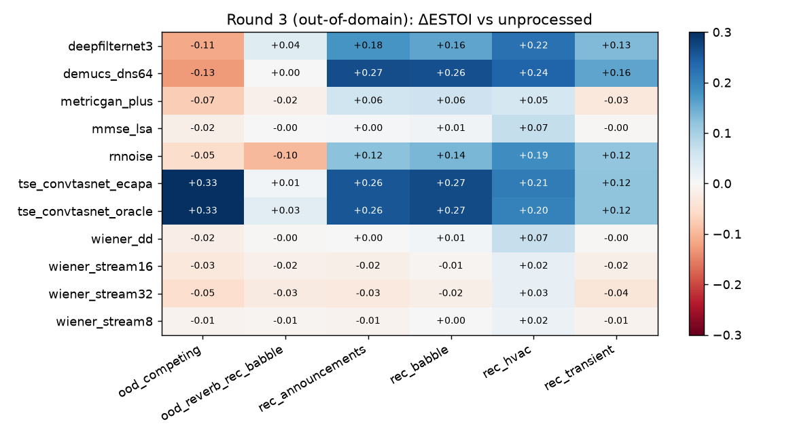
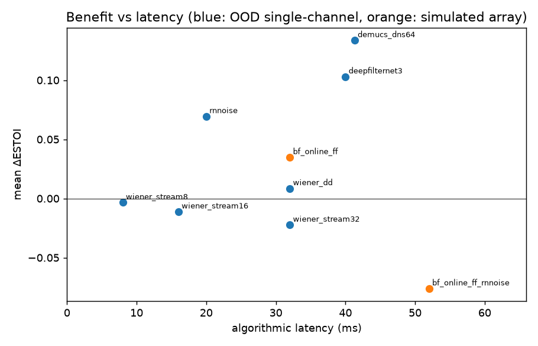

# Speech Enhancement Benchmark Lab — Report

All numbers come from runs in this repository (`results/r1`, `results/r2`, `results/latency.json`). Nothing here is estimated unless it says so. Machine: 2 vCPU aarch64, no GPU.

## 1. Executive summary

- **No method won everywhere.** The best method depends on the kind of interference, and the metric changes the answer.
- **Competing talker: target-speaker extraction (TSE) is the only single-channel method that clearly helped.** The method is Conv-TasNet separation, then picking the stream whose ECAPA speaker embedding matches a ≈10 s enrolment clip of the target. Results:
  - SI-SDR +16.4 dB in round 1 and +15.4 dB in round 2.
  - ESTOI +0.30 (r1) and +0.28 (r2).
  - ASR word-correct rate +0.31 (r1) and +0.43 (r2).
  - Every enhancement-only model *degraded* this condition: Demucs −3.7 dB, MetricGAN+ −4.0 dB.
- **Stationary or non-speech noise: neural denoisers win on SI-SDR, ESTOI and PESQ.** This covers pink, traffic composite and broadband environmental noise. Demucs DNS64 gained +9.6 to +12.2 dB SI-SDR and +0.18 to +0.24 ESTOI across the two rounds. Classical methods gained only +1–4 dB and ≤ +0.08 ESTOI.
- **That objective gain did not carry over to ASR intelligibility.** On those same conditions, Whisper's word-correct rate on Demucs output was unchanged or slightly lower (Δ −0.07 to 0.00). This matches the literature (Hu & Loizou 2007): single-channel enhancement raises SNR-type metrics much more readily than it raises intelligibility.
- **Babble (6 talkers) and reverberant babble are still largely unsolved.**
  - Babble: the best single-channel ESTOI gain was +0.13 (TSE). TSE's ASR word-correct rate moved −0.03 in round 1 and +0.13 in round 2, so the effect was not stable.
  - Reverberant babble: every method landed between −0.09 and +0.04 ESTOI of the unprocessed signal. Most neural models *lowered* SI-SDR in round 2 (Demucs −3.6 dB).
- **In the simulated 4-mic array, cheap spatial filtering gave the largest ASR gains, at a fraction of the compute.**
  - Free-field MVDR with a blind noise mask, at RTF 0.009: word-correct rate +0.35 in babble and +0.26 with a competing talker.
  - DNN-mask MVDR, at RTF 0.39: only +0.15 and +0.04.
  - Adding a Demucs post-filter after the beamformer removed the ASR gain (−0.04 to 0.00).
  - Oracle MVDR (upper bound) reached +0.46 and +0.30.
- **Noise estimation is the bottleneck for classical methods.** Giving Wiener/LSA/spectral subtraction the true noise PSD (round 2) raised SI-SDRi from about +1.6 to +6.3 dB. ESTOI still rose only about +0.04, so even a perfect noise PSD buys little intelligibility.
- **MetricGAN+ games its training metric.** PESQ +0.43–0.48, but SI-SDR −3.5 to −4.0 dB, and ASR word-correct rate −0.15 to −0.19.
- **Offline speed does not mean it can stream.** Demucs DNS64 runs at RTF 0.39 offline. Run frame by frame through its own streamer it was *not* real-time on this CPU: RTF 2.52 with a 41 ms buffer, or 1.05 with an 89 ms buffer. Classical STFT methods need 32 ms of algorithmic latency and <0.1 ms of compute per 8 ms hop.

## 2. What was built
- `selab/` package. Details in README.md.
  - Seeded mixture builder.
  - 4 classical enhancers sharing one blind noise tracker, plus oracle-noise controls.
  - 4 pretrained neural models, plus TSE with ECAPA and oracle stream selection, and a hybrid denoise→TSE.
  - 5 beamformers.
  - Metrics: SI-SDR(i), STOI/ESTOI, PESQ-WB, Whisper base.en WER and word-correct rate.
  - Runtime, RTF, peak RSS and streaming latency.
  - Paired bootstrap analysis.
- **Round 1 (r1)**:
  - Single-channel: 6 conditions × SNR {−5, 0, +5} dB × 8 utterances.
  - 4-mic array: 2 conditions × 3 SNRs × 8.
  - 192 mixtures, 3–8 s each.
- **Round 2 (r2)**:
  - New target utterances, none used in r1, built with a different seed.
  - SNR range widened to {−10, 0, +10} dB, 10 utterances per cell, 180 mixtures.
  - Adds oracle-noise controls and the hybrid.
- Demo app (`app.py`, Gradio). Upload a file, run any of 8 methods, listen, see waveforms and spectrograms, get metrics when a clean reference is uploaded, and export the WAVs. It also browses every benchmark mixture and output with its measured metrics and ASR transcript.

## 3. Results

### 3.1 Round 1, single-channel (n = 144 per method; SepFormer n = 51: 3 utterances per cell, pink +5 dB missing after a job timeout)
Paired deltas vs the unprocessed mixture. wcr is ASR word-correct rate on the first 3 utterances per cell (n = 54).

| method | ΔSI-SDR dB | ΔESTOI | ΔPESQ | wcr | Δwcr | RTF (offline) | peak RSS MB | params |
|---|---|---|---|---|---|---|---|---|
| unprocessed | 0 | 0 | 0 | 0.566 | 0 | – | – | – |
| spectral subtraction | +1.54 | +0.022 | +0.03 | – | – | 0.002 | 269 | – |
| Wiener (DD) | +1.71 | +0.015 | +0.06 | 0.540 | −0.026 | 0.004 | 273 | – |
| MMSE-LSA | +1.68 | +0.018 | +0.07 | – | – | 0.009 | 273 | – |
| noisereduce | +0.14 | +0.009 | −0.03 | – | – | 0.006 | 300 | – |
| MetricGAN+ | −3.49 | −0.004 | +0.43 | 0.375 | −0.191 | 0.043 | 315 | 1.9 M |
| Demucs DNS64 | +5.63 | +0.116 | +0.24 | 0.510 | −0.056 | 0.391 | 931 | 33.5 M |
| SepFormer-WHAM16k (subset) | +2.00 | +0.090 | +0.16 | 0.516 | −0.027 | 3.10* | 1520–1867 | 25.6 M |
| TSE Conv-TasNet+ECAPA | **+8.26** | **+0.176** | **+0.44** | 0.584 | +0.018 | 0.452 | 1168 | 27.2 M |
| TSE, oracle stream pick | +8.39 | +0.178 | +0.44 | 0.589 | +0.023 | (oracle) | | |

\*SepFormer RTF 3.10 was measured idle (smoke run). The batch run measured 5.26 with another job competing for the CPU.
95% bootstrap CIs are in `results/r1/summary.md`. Two examples: TSE ΔESTOI [0.16, 0.20]; Wiener ΔESTOI [0.01, 0.02].

**Per condition, r1 ΔESTOI** (`results/r1/figs/heat_d_estoi.png`):

| | babble | traffic | broadband | pink | competing | reverb+babble |
|---|---|---|---|---|---|---|
| Wiener DD | 0.00 | 0.00 | 0.04 | 0.08 | −0.02 | 0.00 |
| Demucs | 0.10 | 0.23 | 0.23 | 0.24 | −0.10 | −0.01 |
| SepFormer | 0.07 | 0.23 | 0.24 | 0.15 | −0.03 | −0.09 |
| TSE ECAPA | 0.13 | 0.21 | 0.21 | 0.17 | **0.30** | 0.03 |

### 3.2 Round 1, 4-mic array (n = 48; ASR n = 18 per method)

| method | ΔSI-SDR | ΔESTOI | wcr | Δwcr | RTF |
|---|---|---|---|---|---|
| mic 0 unprocessed | 0 | 0 | 0.453 | 0 | – |
| Demucs on mic 0 | −0.68 | −0.018 | 0.414 | −0.039 | 0.39 |
| TSE on mic 0 | +3.57 | +0.062 | 0.469 | +0.016 | 0.45 |
| delay-and-sum | −0.42 | +0.019 | 0.626 | +0.173 | 0.021 |
| MVDR free-field + blind mask | +1.12 | +0.061 | **0.757** | **+0.305** | **0.009** |
| MVDR, DNN (Demucs) mask | +0.57 | +0.021 | 0.546 | +0.093 | 0.39 |
| MVDR DNN mask + Demucs post-filter | +0.05 | +0.025 | 0.433 | −0.020 | 0.77 |
| MVDR oracle covariances (upper bound) | +3.88 | +0.118 | 0.830 | +0.377 | 0.043 |

### 3.3 Round 2 (held-out utterances, −10/0/+10 dB, n = 180; ASR n = 72)

| method | ΔSI-SDR | ΔESTOI | ΔPESQ | wcr | Δwcr |
|---|---|---|---|---|---|
| Wiener DD (blind noise) | +1.63 | +0.010 | +0.09 | 0.540 | −0.016 |
| Wiener DD, **oracle noise PSD** | +6.29 | +0.041 | +0.28 | 0.585 | +0.029 |
| MMSE-LSA, oracle noise | +6.11 | +0.045 | +0.29 | – | – |
| spectral subtraction, oracle noise | +5.24 | +0.047 | +0.17 | – | – |
| MetricGAN+ | −4.02 | −0.004 | +0.48 | 0.406 | −0.150 |
| Demucs DNS64 | +4.11 | +0.088 | +0.36 | 0.542 | −0.014 |
| TSE Conv-TasNet+ECAPA | **+6.92** | **+0.143** | **+0.49** | **0.590** | **+0.034** |
| Demucs → TSE (hybrid) | +4.41 | +0.093 | +0.32 | 0.526 | −0.030 |

**By input SNR (r2, ASR word-correct rate):**

| SNR | unprocessed | Wiener | Wiener + oracle noise | Demucs | TSE |
|---|---|---|---|---|---|
| −10 dB | 0.16 | 0.14 | 0.19 | 0.13 | **0.25** |
| 0 dB | 0.61 | 0.61 | **0.69** | 0.62 | 0.66 |
| +10 dB | **0.90** | 0.87 | 0.87 | 0.87 | 0.85 |

At +10 dB every method *reduced* ASR accuracy slightly: processing artifacts cost more than the noise they removed.

### 3.4 Latency and real-time feasibility (`results/latency.json`, idle machine)

| method | algorithmic latency | compute | real time on this CPU? |
|---|---|---|---|
| spectral subtraction / Wiener / LSA | 32 ms window | 0.015 / 0.026 / 0.074 ms per 8 ms hop | yes, by about 100× |
| Demucs DNS64, streaming, 1 frame | 41.3 ms | 40.4 ms per 16 ms stride (RTF 2.52) | **no** |
| Demucs DNS64, streaming, 4 frames | 89.3 ms | 66.9 ms per 64 ms stride (RTF 1.05) | **no** (borderline) |
| MetricGAN+, SepFormer, Conv-TasNet TSE | non-causal (whole utterance) | offline RTF 0.04 / 3.1 / 0.45 | not streamable as released |
| MVDR (as implemented) | utterance-level covariances | RTF 0.009–0.04 | offline; needs recursive covariance updates to stream |

The review documents latency tolerances: about 20 ms for closed fittings and about 5–6 ms for open fittings (Stone & Moore). By that standard, none of the neural models here meets an open-fit budget even with infinite compute.

## 4. Surprises
1. **Objective gains and ASR gains disagree.** Demucs added +9.6 to +12.2 dB SI-SDR on pink, traffic and broadband noise, yet ASR word-correct rate did not improve. Whisper is noise-robust and is sensitive to enhancement artifacts. This is a known effect in the ASR literature, and it means ASR is a weak stand-in for human intelligibility in both directions.
2. **Delay-and-sum on a 12 cm array barely moved SI-SDR (−0.4 dB) but raised ASR word-correct rate by +0.17.** That suggests the ASR rewards attenuating the interfering *speech* stream, which also stops the competing talker's words being transcribed, in ways SI-SDR does not capture.
3. **The beamformer with a DNN post-filter did worse than the beamformer alone on ASR.** Stacking "the best of both" was not additive.
4. **The hybrid Demucs→TSE split by noise type.** On non-speech noise it beat TSE alone (pink: +10.6 vs +6.5 dB SI-SDR, +0.18 vs +0.14 ESTOI). With a competing talker it collapsed (+1.8 vs +15.4 dB), and in babble it lost too (−0.8 vs +2.9 dB). Likely cause (not tested): the denoiser keeps both voices but adds artifacts, which gives the separator a harder problem. Routing by interference type would beat any fixed cascade.
5. **ECAPA picked the same stream as the oracle in 95.8% of r1 mixtures.** The exceptions were mostly array-competing and reverberant cases, at 88% each. Selection error is not the limiting factor; separation quality is.

## 5. Critique as a skeptical reviewer, and what round 2 changed
| concern | effect on conclusions | round-2 action |
|---|---|---|
| Classical methods may lose only because of a weak noise tracker | could understate classical | oracle-noise controls added. Gap confirmed as noise estimation (+4.6 dB SI-SDR), but ESTOI and ASR gains stay small |
| Round-1 utterances reused across analysis, risking overfitting of conclusions | inflated certainty | r2 uses new target utterances only (none from r1), a new seed, and 10 per cell |
| SNR range too narrow | misses failure regimes | r2 covers −10 and +10 dB. TSE's edge grows at −10 dB; all methods hurt slightly at +10 dB |
| Too few ASR samples | noisy WER | r2 ASR n = 72 per method. Word-correct rate added because WER is inflated by insertions (competing-talker words, hallucinations) |
| In-domain advantage for TSE: Conv-TasNet was trained on Libri2Mix (LibriSpeech) and tested on LibriSpeech speakers | **likely optimistic for TSE**, especially competing-talker | **not fixed**: no out-of-corpus speech was available offline. Top next experiment |
| Babble and competing talkers also drawn from LibriSpeech | same bias | not fixed |
| Synthetic rooms and arrays, ideal mic matching, known target direction | beamforming optimistic (free-field steering used the true azimuth) | partially addressed: MVDR-ff estimated noise blindly, but steering is still oracle-direction |
| ASR proxy is Whisper base.en, which may share training data with LibriSpeech | absolute WER optimistic; deltas more trustworthy | flagged |
| No loudness normalisation before listening | perceptual bias in the listening pack | flagged in the listening page |
| CPU contention during some batch runs | some RTFs inflated | idle measurements used where available (SepFormer smoke, latency.json). r2 RTFs not used for comparisons |
| PESQ applied to separated speech and low-SNR inputs where it is poorly validated | PESQ deltas less trustworthy than ESTOI | reported, but not used to rank |

## 6. Limitations and unresolved questions
- No human listening test was run. Whisper word-correct rate is a proxy, and the methods above show that proxy and objective metrics can diverge.
- Single corpus (LibriSpeech read speech, 26 speakers in total), synthetic noise mixing, and simulated rooms.
- The 'traffic' condition is an ESC-50 composite: engine/train bed plus horns and sirens. It is not a recorded street.
- No conversational, Lombard or far-field real recordings. No real multichannel data.
- DeepFilterNet and RNNoise could not be built in rounds 1-2. Both were built and benchmarked in round 3 (§8).
- Every processed signal here is digital output. None of it says anything about acoustic noise reaching a listener's ear (passive, ANC or leakage); see review §8.
- Open: does TSE's competing-talker advantage survive out-of-domain speakers and real rooms? Does any method raise *human* keyword recognition in babble?

## 7. Recommended next experiments (highest information value first)
1. **Out-of-domain stress test for TSE and Demucs.** Use a non-LibriSpeech corpus (e.g. VCTK or conversational speech) with *recorded* noise (DEMAND or WHAM!), keeping the same pipeline. This decides whether the headline TSE result is real or an artifact of matching training and test data.
2. **A small human keyword-recognition test.** Use a randomised, blinded web form with matrix sentences or keyword scoring, built from the existing listening pack. Unprocessed vs Wiener vs Demucs vs TSE vs MVDR-ff, at the SNRs where the proxies disagree (0 dB babble, 0 dB pink). It is the only way to settle whether the ESTOI gains or the ASR results reflect real listeners.
3. **Streaming-constrained comparison.** Implement recursive-covariance MVDR plus a causal mask, and test DeepFilterNet or another low-latency causal DNN on a machine that can build it. Score everything at a fixed latency budget (e.g. ≤10 ms and ≤40 ms), on real multi-mic recordings with an estimated, not known, target direction. Today the cheapest method (MVDR-ff) looks best per unit of compute, but only under oracle steering and offline covariances.

## 8. Round 3: executing the recommended experiments (2026-10-15)

All numbers are measured. Full tables are in `results/r3/summary_r3.md`, `generalisation_gap.csv` and `latency_budget.csv`; the run and its failures are in EXECUTION_LOG.md items 16-25. Reproduce with `scripts/run_round3.sh` followed by `python -m selab.analyze_r3`.

**New this round.** RNNoise (pyrnnoise wheel; its 20 ms delay is measured and compensated) and DeepFilterNet3 (built from source with a user-space Rust toolchain and zig as the linker). Both also ran on r1 and r2. Also new: an out-of-domain set (r3), true hop-by-hop streaming implementations, and a blinded human listening-test app.

### 8.1 Out-of-domain test (144 mixtures: CMU ARCTIC talkers incl. Scottish- and Indian-English targets; recorded MS-SNSD noise)
| method | ΔSI-SDR dB | ΔESTOI [95% CI] | ΔPESQ | Δ ASR word-correct [95% CI] | RTF |
|---|---|---|---|---|---|
| TSE Conv-TasNet + ECAPA | +10.2 | +0.199 [0.177, 0.222] | +0.54 | **+0.11 [0.04, 0.17]** | 0.91 |
| Demucs DNS64 | +7.1 | +0.134 [0.107, 0.161] | +0.38 | -0.02 [-0.06, 0.02] | 0.61 |
| DeepFilterNet3 | +4.9 | +0.103 [0.083, 0.122] | +0.36 | -0.05 [-0.09, -0.01] | 0.088 |
| RNNoise | +3.1 | +0.069 [0.050, 0.088] | +0.15 | -0.09 [-0.14, -0.05] | 0.092 |
| Wiener (DD) | +1.4 | +0.009 [0.003, 0.014] | +0.03 | -0.02 [-0.05, 0.00] | 0.004 |
| MetricGAN+ | -4.3 | +0.009 [-0.005, 0.022] | +0.43 | -0.12 [-0.17, -0.07] | 0.04 |

- **The headline TSE result survives the domain shift.** Competing talker OOD: +16.2 dB SI-SDR, +0.33 ESTOI, +0.54 ASR word-correct rate, against +15.8 dB / +0.29 in-domain. The ECAPA-selected output matches the oracle-selected one to within 0.4 dB overall. It is the only method whose ASR gain is positive with a CI excluding zero.
- **No method collapsed out of domain.** On recorded babble, every neural method gained *more* than on the in-domain LibriSpeech-built babble (Demucs ΔESTOI +0.26 vs +0.07). That is consistent with recorded crowd babble being less target-like than babble built from the same corpus as the target. It is a hypothesis, not tested.
- **Objective/ASR disagreement replicates out of domain.** DeepFilterNet3 and RNNoise raise ESTOI on every recorded-noise condition but *lower* ASR word-correct rate overall. Reverberant OOD babble stays unsolved (all methods within -0.10 to +0.04 ESTOI).
- **RNNoise harms babble, reverberation and competing speech** in every round (r1 babble ΔESTOI -0.14, reverb_babble -0.18). Its benefit is limited to stationary or quasi-stationary noise.

### 8.2 Latency-budget comparison (algorithmic latency = window + lookahead)
| budget | best measured option | ΔESTOI | Δ ASR wcr | compute |
|---|---|---|---|---|
| ≤10 ms | streaming Wiener, 8 ms window | -0.003 (no benefit) | n/a | 0.055 ms per 4 ms hop |
| ≤20 ms | RNNoise | +0.069 OOD (but -0.09 ASR) | -0.09 | RTF 0.092 |
| ≤40 ms | DeepFilterNet3 | +0.103 OOD | -0.05 | RTF 0.088 (offline batch) |
| ≈41 ms | Demucs streaming | +0.134 | -0.02 | **RTF 2.52 at 1 frame: not real-time here** |
| 32 ms, 4 mics (simulated) | online MVDR, free-field steering | +0.035 | **+0.24** (offline MVDR +0.31) | 0.23 ms per 16 ms hop |
| 52 ms, 4 mics | online MVDR → RNNoise | -0.076 | -0.10 | 0.23 ms per hop + RNNoise |

- **Below ≈16 ms nothing single-channel helped.** The hop-by-hop Wiener filters with online minimum-statistics noise tracking gave slightly *negative* ESTOI on the OOD set. The offline Wiener with the same 32 ms window scored +0.009. The gap is the cost of tracking noise causally.
- **For a real-time CPU budget, DeepFilterNet3 is the best single-channel option measured:** 84-96% of Demucs's ESTOI gain on stationary and environmental noise (r1 pink, broadband, traffic; r3 HVAC, transients), at about 1/7 of Demucs's compute and with a 40 ms latency it can actually meet. Its frame-by-frame compute was not measured: the Python API is batch-only.
- **With multiple microphones, the online recursive MVDR keeps most of the offline ASR gain** (+0.24 vs +0.31 word-correct) at under 1.5% of one core. Adding RNNoise after it erases the gain, the same pattern as Demucs post-filtering in round 1.
- Caveat: the MVDR rows still use the *known* target azimuth and simulated rooms. Steering-error robustness and real recordings remain untested.

### 8.3 Blinded listening test: built, not run on people
`listening_test.py` serves a Gradio test. It draws 48 trials per listener from the OOD set (4 conditions × 0/-5 dB × 6 sentences). Six processing conditions are assigned by a cyclic Latin square, so each listener hears each sentence once and each method 8 times. Stimuli are RMS-equalised under opaque file names, playback is limited to one play, and listeners type the words they heard and rate listening effort. Scoring is the same word-correct rate as the ASR proxy, logged to CSV, and `--analyze` gives per-method bootstrap CIs. Verified: the app answers HTTP 200, the Latin-square balance was checked programmatically, and a synthetic-listener run (`--selftest`, Whisper standing in for a person, tagged `synthetic`) exercises the whole record → score → analyse path. **No human data exists yet.** Rough power: the trial-level SD of word-correct rate in the matching ASR data is about 0.36. With about 12 listeners (96 trials per method), the 95% CI half-width on a method mean is about ±0.07 (unpaired; paired within-sentence contrasts should be tighter). That is enough to detect the 0.1-0.5 differences seen for TSE in competing speech, but not the few-hundredths gaps between denoisers.

### 8.4 What changed in the conclusions
1. TSE's competing-talker advantage is not a LibriSpeech artifact (it was the main open question from §6).
2. A deployable real-time single-channel tier now exists in the comparison: DeepFilterNet3 at 40 ms. RNNoise belongs to stationary noise only.
3. For multi-mic capture, the cheapest causal method (online MVDR) remains the one that most consistently helps the ASR proxy. It should be paired with steering estimation, not a DNN post-filter.
4. Still open: human intelligibility (the test is ready to run), real multichannel recordings, estimated rather than known direction, and reverberant babble.
