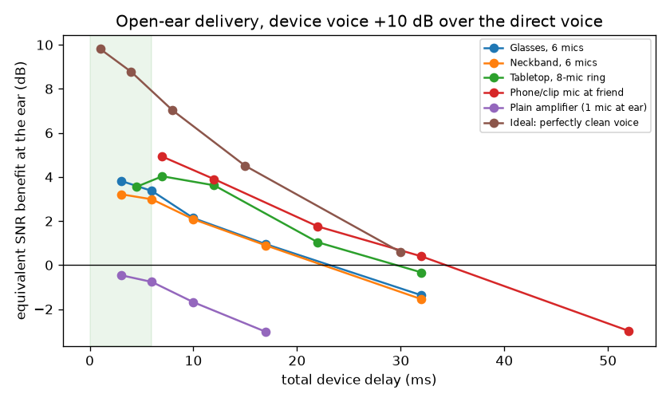
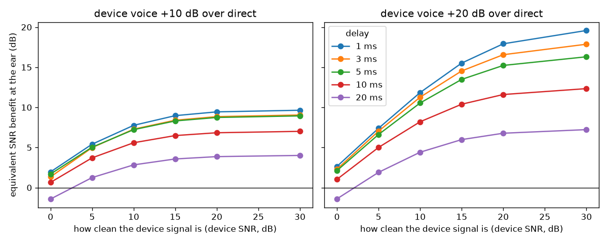

# 1. Questions

1. If a device *adds* a cleaned-up copy of your friend's voice while the room noise still reaches your ear (no earbuds), how many dB does that help? How does it depend on delay, loudness, and form factor (glasses, neckband, tabletop, phone at the friend)?
2. What approaches could reduce perceived noise at the scale of one person or one table, including active noise control, beamforming and prediction? What does the research and market already show?

# 2. Simulation method (all numbers in this section are measured in simulation)

- **Scenes.** 21 simulated bars, each run at 2 input SNRs, giving 42 conditions.
  - Shoebox rooms 10–14 × 8–11 × 3.5 m, RT60 0.55–0.85 s (pyroomacoustics image method).
  - The listener is seated. The friend speaks from 1.0 m across the table.
  - Noise comes from 8 babbling talkers at 1.6–5 m, plus 2 ceiling loudspeakers playing recorded crowd babble (MS-SNSD).
  - Input SNR at the ear is −5 or 0 dB, which is typical of a 75–80 dBA bar.
- **Form factors.** Each uses a fixed superdirective beamformer steered at the friend, built as a causal FIR with 2 ms latency (an 8 ms version was also tested):
  - glasses: 6 mics on the frame;
  - neckband: 6 mics on a U-shape, 20 cm below the ears;
  - tabletop: an 8-mic ring, 10 cm across, at the table centre;
  - remote: a phone or clip mic on the friend's chest;
  - plain amplifier: 1 mic at the ear, no beamforming.
- **What the listener hears.**
  - Open ear: ear = direct sound + gain × delayed device output.
  - In-ear comparison: the direct sound is attenuated 25 dB.
  - Total delays tested: 1 to 52 ms. Wireless links add 5–50 ms.
  - Device loudness: the device's voice is 0, +10 or +20 dB louder than the friend's direct voice.
- **Ceiling.** An *ideal* device that emits the perfectly clean voice.
- **Capture sweep.** A device emitting the voice at a controlled cleanliness (device SNR 0–30 dB) shows how good the capture front-end must be.
- **Metric.**
  - ESTOI at the ear, converted to *equivalent SNR benefit* in dB. This is the shift in unaided SNR that would give the same intelligibility, computed from a per-scene curve.
  - It is directly comparable to the dB benefits reported for hearing glasses (Nuance Audio: +2.2 to 4.4 dB measured on people).
- **Limitations.**
  - No head or torso acoustics (no head shadow) and no acoustic feedback model.
  - Static talkers and fixed steering. A real device needs to track who you look at.
  - ESTOI is a proxy, not human listening.
  - +20 dB device gain at an open ear means very high playback levels (about 90+ dB SPL in a loud bar) and feedback risk. Treat +10 dB as the realistic setting.

# 3. Simulation results

**Benefit by form factor, open ear, shortest delay** (mean and 95% bootstrap CI):

| Form factor | Delay | +10 dB louder | +20 dB louder |
|---|---|---|---|
| Glasses, 6 mics | 3 ms | **+3.8 dB** [3.6, 4.1] | +4.7 dB |
| Neckband, 6 mics | 3 ms | +3.2 dB [3.0, 3.5] | +4.2 dB |
| Tabletop 8-mic ring | 4.5 ms | +3.6 dB (peak +4.0 dB at 7 ms) | +5.3 dB |
| Phone/clip mic at friend | 7 ms | **+4.9 dB** [4.6, 5.3] | +6.3 dB |
| Plain amplifier (no array) | 3 ms | −0.5 dB | −0.2 dB |
| Ideal, perfectly clean voice | 1 ms | +9.8 dB | +19.7 dB |

**Findings**

1. **Validation.** The glasses result (+3.8 to +4.7 dB) lands inside the +2.2 to 4.4 dB measured on real hearing glasses. The model is in the right range.
2. **Every form factor today is stuck at about 3–6 dB, and the limit is capture quality, not delivery.**
   - The device's own signal is only about 1–2 dB cleaner than what already reaches the ear (beamformers) or about 5 dB cleaner (mic on the friend).
   - In a reverberant babble field, small arrays have limited directivity.
3. **A plain amplifier makes things slightly worse** (−0.5 to −3 dB): it amplifies the noise too and adds delay smear.
4. **Delay is expensive.**
   - With a perfectly clean voice at +10 dB: about +9.8 dB at 1 ms, +7.0 dB at 8 ms, +4.5 dB at 15 ms, +0.6 dB at 30 ms.
   - For real arrays, benefit is about halved by 10–17 ms and is negative past about 30 ms.
   - A Bluetooth-class link (about 20–50 ms) erases most of a remote mic's advantage, from +4.9 dB at 7 ms down to −3.0 dB at 52 ms.
5. **Adding an 8 ms neural/Wiener post-filter hurt** on every form factor, because its delay cost more than its noise reduction gained.
   - Example: glasses +3.8 dB → +2.6 dB.
   - This confirms round 3: at an open ear, any processing must fit in about 5 ms.
6. **Sealing the ear (in-ear, 25 dB isolation) adds only about 1 dB with today's beamformers** (glasses +4.8 vs +3.8 dB).
   - It adds about 17 dB with a perfectly clean voice.
   - Isolation only pays off once the captured voice is clean.
7. **How clean must the device signal be?** Capture sweep, open ear, <=5 ms delay:

| Device signal cleanliness (SNR) | +10 dB louder | +20 dB louder |
|---|---|---|
| 0 dB (~ today's beamformers) | +1.7 to 2.0 dB | +2.1 to 2.6 dB |
| 5 dB (~ remote mic) | +5.0 dB | +6.6 to 7.4 dB |
| 10 dB | +7.2 dB | +10.5 to 11.8 dB |
| 15 dB | +8.3 dB | +13.5 to 15.5 dB |
| 20 dB | +8.7 dB | +15.2 to 17.9 dB |

   - At 20 ms the same signals give only +1.2 to 6.8 dB.
   - **Design target:** capture the friend at >=10 dB SNR and deliver within <=5 ms. That roughly doubles today's open-ear benefit, to about +7 dB at a comfortable +10 dB playback level.
   - Getting there needs a larger aperture (table array, distributed mics) plus low-latency voice-aware separation. Causal TSE reached about 7 dB SI-SNRi at 12 ms in UW's 2024 work.

**Predictive traffic noise** (separate street-café experiment, 8 ms streaming Wiener filter, 30 utterances × 3 SNRs):

| Noise estimate | ΔSI-SDR | ΔESTOI |
|---|---|---|
| Blind minimum-statistics tracker (usual) | +0.8 dB | +0.011 |
| Fast blind tracker | +0.7 dB | −0.027 |
| **Predictive** (car pass-by forecast from an up-street sensor, ±2 dB error) | **+3.7 dB** | +0.023 |
| Oracle (true noise, not deployable) | +5.2 dB | +0.111 |

- Forecasting the pass-by swell gives clearly cleaner signal (+2.9 dB SI-SDR over blind tracking). The intelligibility gain is small.
- **Verdict:** a useful comfort feature (less "whoosh") inside a device that already processes audio. It is not a standalone solution.

# 4. Solution landscape (from two research tracks; sources in `docs/research_open_air_anc.md` and `docs/research_hearing_tech.md`)

**Physics constraints**
- Open-air active noise control makes a quiet zone only about λ/10 wide: 34 cm at 100 Hz, 6.8 cm at 500 Hz, 3.4 cm at 1 kHz.
- It needs a reference signal that is coherent with the noise. Crowd babble defeats both.
- Measured open-air ANC lives below about 1 kHz:
  - about 20 dB at 300 Hz–1 kHz at a head-tracked headrest (Elliott 2018, idealised);
  - 7.5–10 dB through an open window, 24 speakers (Lam 2020);
  - about 3 dB road noise in production cars (Hyundai/Harman).

**Candidate solutions, with maturity and expected benefit**

1. **Table hub + near-ear delivery (recommended core).**
   - A centerpiece mic array picks up each tablemate close to the mouth, then runs beamforming and low-latency separation on mains power.
   - It streams over a sub-5 ms proprietary link (not standard Bluetooth) to each person's neckband or open-ear glasses.
   - Expected: +4 dB with today's beamformer, up to +7 to 10 dB if capture reaches >=10 dB SNR (simulated).
   - Prior art and competitors: Phonak Roger Table Mic and Roger On Sphere (needs hearing aids), Orsana (earbuds), the TableConverse patent US 12,354,619 (2025), TableTalk Labs.
   - Maturity: components shipping; the integrated earbud-free product does not exist.
2. **Smart neckband ("virtual headphones").**
   - 6–8 chest/neck mics, about 15–20 cm aperture.
   - Speech delivered from near-field differential speakers about 15 cm from the ear, with low spill to neighbours.
   - Optional bass ANC below about 500 Hz, where the quiet zone is large enough.
   - Measured precedent: Widrow's chest array gave >10 dB HINT benefit (2003); a 6-mic necklace gave 7.5 dB.
   - Simulated here: +3.2 dB alone, more when paired with the table hub.
   - White space commercially.
3. **Gaze-steered open-ear glasses.**
   - Uses eye tracking now arriving in smart glasses to steer the beam at whoever you look at.
   - Measured: 8–12 dB attenuation in lab VGHA (BU) work; Nuance Audio +2.2 to 4.4 dB.
   - Simulated: +3.8 dB at 3 ms.
   - Competitors: Nuance Audio / Audio Plus ($699–$829, FDA OTC), Meta Ray-Ban Conversation Focus (no data published), Legato ($12M, Aug 2026, AI hearing glasses).
   - Mature category, crowded.
4. **Chair-back / booth "quiet seat" (venue product).**
   - Headrest ANC handles the bass of music and HVAC. Lab: about 10–20 dB at 300 Hz–1 kHz; Silentium claims up to 10 dBA at 30 Hz–1 kHz.
   - A booth active aperture handles noise entering the open side: about 5–10 dB at 300 Hz–1 kHz (window-ANC analogue).
   - Seat-back speakers deliver the boosted voice.
   - Helps less with speech-band babble, and only when people lean back.
   - Lab to pre-production. Sold to venues, not consumers.
5. **"Duck the DJ": venue-feed cancellation (creative, speculative).**
   - The house music is the one loud bar noise that is known electronically *before* it plays.
   - A venue-connected hub sends it to the neckband or chair as a perfect ANC reference: MUTE-style lookahead (SIGCOMM 2018 cancelled 0–4 kHz with lookahead).
   - Alternatively, the venue simply EQ-ducks its own speakers near tables that request it.
   - Expected: large cuts in music bass at the seat; zero hardware cost to the guest for the ducking version.
6. **Predictive noise forecasting (measured here, modest).**
   - Up-street or door sensors, or traffic-light timing, forecast car and bus pass-bys.
   - The suppressor pre-adapts so the noise swell is removed rather than chased: +3.7 vs +0.8 dB SI-SDR in our test.
   - Also anticipatory gain riding of the friend's voice.
   - A comfort feature that layers onto 1–3.
7. **Overhead parametric "speech spotlight" (creative).**
   - An ultrasonic beam from a pendant lamp delivers each tablemate's voice to one head. Max 85–95 dB SPL, beam about 0.5 m at 2 m.
   - Realistic gain about +5 to 10 dB, with weak bass and head-tracking needed.
   - Hardware exists (Holosonics). Noveto, the ear-tracking pioneer, appears defunct.
   - Ultrasound exposure needs checking.
8. **"Babble thinning" psychoacoustics (speculative).**
   - Make *nearby intelligible* conversations less distracting with targeted masking, rather than louder. This reduces informational masking.
   - Could backfire, since it adds noise. Needs listening tests.
9. **Venue acoustics partnership.**
   - Absorptive ceilings: up to about 10 dB reverberant reduction (vendor claim).
   - Also slows the Lombard spiral, where everyone talks louder.
   - Mature, and complementary to any device.

**Distributed / phones idea:** friends' phones on the table form an ad-hoc array (UIC research). But standard Bluetooth delay (about 20 ms+) costs most of the benefit at an open ear, as section 3 shows. It suits in-ear delivery or transcription better.

# 5. Recommendation and next experiments

- **Wedge.** Table hub (capture + compute) plus neckband or glasses (delivery), with a sub-5 ms custom radio link.
  - The simulation says capture quality is the lever.
  - The table is where the large aperture, power and closeness to talkers live.
- **Must-prove metrics.**
  - Friend captured at >=10 dB SNR, end-to-end <=5 ms.
  - Open-ear playback at about +10 dB without feedback.
  - Target: >=+6 dB measured SRT benefit, versus 2–4 dB for hearing glasses today.
- **Next experiments.**
  - (a) A causal TSE or separation model at <=5 ms on table-array signals in these scenes.
  - (b) Add a head/torso model and acoustic feedback.
  - (c) Build a mic-array dev-board prototype and record in a real Omaha restaurant.
  - (d) Run a human listening test using the existing blinded test app.

# 6. Files

- **Code:** `selab/openear.py`, `selab/openear_capture.py`, `selab/predictive_traffic.py`, `selab/analyze_r4.py`.
- **Results:** `results/r4/summary_r4.md`, `benefit_by_form.csv`, `benefit_vs_delay.csv`, `open_vs_inear.csv`, `capture_sweep_summary.csv`, `predictive_traffic_summary.csv`.
- **Figures:** `results/r4/figs/benefit_vs_delay.png`, `capture_sweep.png`.
- **Audio examples:** `results/r4/audio/`.
- **Research:** `docs/research_open_air_anc.md`, `docs/research_hearing_tech.md`.

{width=85%}

{width=100%}
