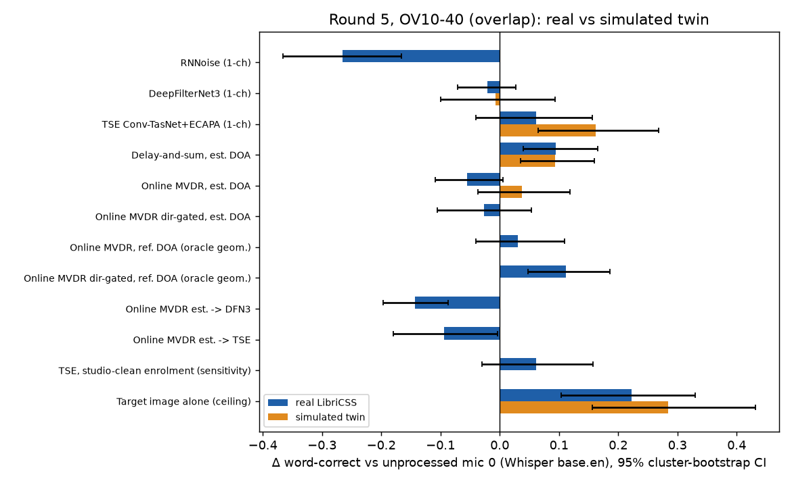
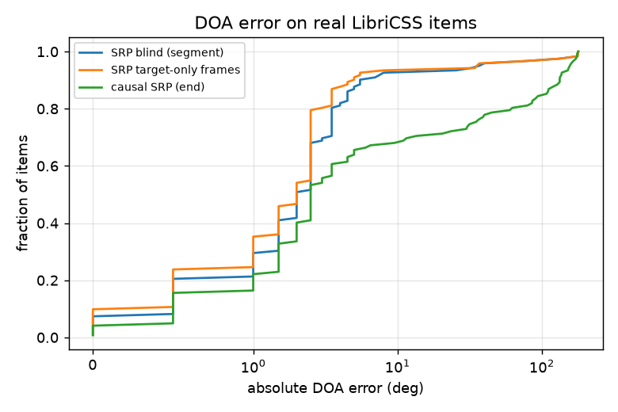
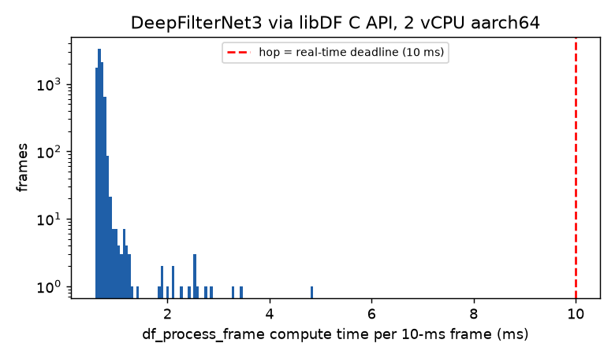

# 1. Bottom line

1. **Real recordings tell a less flattering story than simulation.** On 48 real, partly overlapped meeting-room items, the only method with a clear benefit was the cheapest one: delay-and-sum beamforming with an estimated direction, +0.073 word-correct [95% CI +0.029, +0.127] overall and +0.095 [+0.040, +0.165] on overlapped speech. It survives a Holm correction.
2. **Several methods made things worse on the real recordings:**
   - The causal online MVDR that looked best in simulation in rounds 1-3: −0.054 [−0.096, −0.009].
   - DeepFilterNet3 alone: about neutral at −0.021 [−0.059, +0.017].
   - Both cascades: online MVDR → DeepFilterNet3 −0.129 [−0.170, −0.086], and online MVDR → TSE −0.102 [−0.168, −0.031].
   - Single-channel target-speaker extraction (TSE) gained +0.033 [−0.039, +0.113]. That is far below its simulated +0.16 to +0.54.
3. **The fitted twin is good for some methods and optimistic for others.** It reproduces delay-and-sum (real +0.095 vs sim +0.093 on overlap), DeepFilterNet3 and every method on no-overlap speech. It overstates TSE by 0.10 [0.03, 0.18] and online MVDR by 0.09 [0.01, 0.18] word-correct. The generic simulations of rounds 1-3 overstated these methods 3-8× more.
4. **Direction finding works on real data, but it is not the whole problem.**
   - Blind SRP-PHAT is within 10° of the reference on 100% of no-overlap items and 90% of overlapped items (median error 2.0-2.5°).
   - Even with the *reference* direction, online MVDR only reaches +0.031 on overlap.
   - The direction-gated variant with the reference direction reaches +0.112 [+0.047, +0.186]. With the *estimated* direction the same variant gives −0.026. Hop-level tracking errors during overlap therefore cost about 0.14 word-correct.
5. **DeepFilterNet3's real-time path is cheap.**
   - Measured frame by frame through its Rust C API: median 0.68 ms, p99 0.84 ms, worst 4.9 ms of compute per 10-ms frame (RTF 0.069). No frame missed its deadline.
   - Its 40 ms *algorithmic* latency, not compute, is what rules it out for open-ear use (round 4: an open-ear device needs about 5 ms or less).
6. **A gain-staging bug was found and fixed.**
   - The real recordings sit at about −53 dBFS. Fed at that level, DeepFilterNet3 erased almost everything (WER 0.98).
   - Normalising the input to −26 dBFS fixed it.
   - Any real device needs explicit gain staging before a neural model.
7. **What this does not show.** Everything here is recorded audio, processed and then scored by an ASR proxy (Whisper base.en). None of it measures what physically reaches a listener's ear, and nothing here reduces the sound at the ear. Section 9 sets out what transfers to real-world listening and what does not.

# 2. What ran

**Data: LibriCSS** (Chen et al., ICASSP 2020). LibriSpeech test-clean (CC BY 4.0) was replayed through 8 loudspeakers in a real meeting room and recorded with a 7-mic circular array (centre mic plus 6 mics on a 4.25 cm radius).

- 24 ten-minute recordings were pulled by HTTP range reads of the 6.0 GB zip: conditions 0S (no overlap), OV10, OV20 and OV40 × sessions 0-5.
- 6 target utterances per recording (3-15 s; the OV items are overlapped by more than 5%), giving **144 items**.
- Statistics are clustered by **recording (24 clusters)**.

**References: system identification, used only for scoring and the DOA check, never by a method.**

- Per item, the RIRs from each dry loudspeaker feed to the 7 mics were estimated by least squares, with clock drift (~14 ppm) and offset fitted.
- The target reference is the dry feed convolved with its estimated RIR at mic 0, an *estimated* reverberant target image. The median residual is −10 dB.
- The reference azimuth comes from direct-path TDOAs. It is validated by self-consistency: 29 loudspeaker positions were seen in 2-4 independent recordings and agree with their circular median within a median of 1.0° and at worst 3.0°.

**Simulated twin (mixtures/r5sim): the same 144 items.** It uses the same dry feeds, timing, overlap, geometry, azimuths and levels, and the *real* 7-channel room noise from the same recording.

- Room: pyroomacoustics shoebox, 6.5 × 5 × 3 m (assumed).
- RT60 0.32 s: the envelope-slope median over 24 identified RIRs, IQR 0.31-0.36 s.
- Each loudspeaker's distance was fitted so that the simulated direct-to-reverberant ratio matches the identified one.

**Methods.** Processing ran on all 144 real items unless marked n = 48. The 48-item panel is 2 items per recording.

- Single-channel on mic 0: RNNoise (n = 48 after the gain fix), DeepFilterNet3 (n = 48), and TSE (Conv-TasNet separation plus ECAPA selection, using an enrolment utterance of the same talker).
- Multichannel:
  - delay-and-sum steered by whole-segment SRP-PHAT;
  - online MVDR (32 ms window, 16 ms hop, causal SRP tracker), plus a direction-gated variant;
  - both online MVDR variants with the *reference* azimuth as an oracle-geometry control;
  - cascades: online MVDR → DeepFilterNet3 and online MVDR → TSE (n = 48).
- The twin ran the core set on its own items: unprocessed, delay-and-sum and online MVDR on 144; DeepFilterNet3 and TSE on the 48-item panel.

**Scoring.**

- Whisper base.en (int8, greedy; the same settings as rounds 1-4) gives WER and **word-correct** (hits ÷ reference words, the primary measure). Insertions are reported separately.
- SI-SDR and ESTOI are computed against the estimated reference (real) or the exact reference (twin).
- ASR n: 48 items per method on the panel (unprocessed and the target-image ceiling have more). The twin ASR covers the same 48 items, so sim-vs-real is paired by item.

**Statistics.** 95% CIs come from a cluster bootstrap over recordings (2000 resamples) of paired deltas (method minus unprocessed mic 0 on the same item). The Holm adjustment is applied within each group of 11 method comparisons.

Everything is reproducible:

- `scripts/run_round5.sh` builds the data and the twin.
- `scripts/r5_finish_proc3.sh`, `r5_finish_proc4.sh` and `r5_finish_asr3.sh` finish the processing and ASR.
- `python -m selab.analyze_r5` writes the analysis.
- Tables are in `results/r5/summary_r5.md`, `asr_summary.csv`, `objective_summary.csv` and `sim_vs_real.csv`.

# 3. Results on the real recordings

**Core methods on one common item set** (n = 48 items, 24 recordings, all conditions):

| Method | WER | word-correct | Δ word-correct [95% CI] |
|---|---|---|---|
| Unprocessed mic 0 | 0.309 | 0.716 | 0 |
| **Delay-and-sum, est. DOA** | **0.220** | **0.789** | **+0.073 [+0.029, +0.127]** |
| TSE (1-ch) | 0.285 | 0.749 | +0.033 [−0.039, +0.113] |
| DeepFilterNet3 (1-ch, gain-staged) | 0.336 | 0.695 | −0.021 [−0.059, +0.017] |
| Online MVDR, est. DOA (causal, 32 ms) | 0.373 | 0.662 | −0.054 [−0.096, −0.009] |
| Online MVDR → TSE | 0.425 | 0.614 | −0.102 [−0.168, −0.031] |
| Online MVDR → DeepFilterNet3 | 0.846* | 0.587 | −0.129 [−0.170, −0.086] |

\*0.43 insertions per reference word: Whisper got caught in repetition loops on several cascade outputs. Word-correct is unaffected by insertions, which is why it is the primary measure.

**Overlapped items only** (OV10-40, n = 36 items, 18 recordings). p is the cluster-bootstrap p-value; "Holm" is the adjusted p over 11 comparisons:

| Method | Δ word-correct [95% CI] | p (Holm) |
|---|---|---|
| Delay-and-sum, est. DOA | **+0.095 [+0.040, +0.165]** | <0.001 (<0.001) |
| Online MVDR dir-gated, **reference** DOA (oracle geometry) | +0.112 [+0.047, +0.186] | <0.001 (<0.001) |
| TSE | +0.062 [−0.041, +0.156] | 0.23 (1.0) |
| Online MVDR, reference DOA (oracle geometry) | +0.031 [−0.040, +0.109] | 0.42 (1.0) |
| DeepFilterNet3 | −0.021 [−0.071, +0.027] | 0.41 (1.0) |
| Online MVDR dir-gated, est. DOA | −0.026 [−0.106, +0.054] | 0.48 (1.0) |
| Online MVDR, est. DOA | −0.055 [−0.108, +0.006] | 0.09 (0.56) |
| Online MVDR → TSE | −0.094 [−0.180, −0.003] | 0.04 (0.30) |
| Online MVDR → DeepFilterNet3 | −0.143 [−0.197, −0.087] | <0.001 (<0.001) |
| RNNoise (gain-staged) | −0.265 [−0.366, −0.166] | <0.001 (<0.001) |
| *Ceiling: estimated target image alone* | *+0.222 [+0.104, +0.330]* | |

**No-overlap items** (0S, n = 12 items, 6 recordings):

- Nothing helped.
- Delay-and-sum was neutral (+0.008 [−0.011, +0.027]).
- Online MVDR (−0.050 [−0.088, −0.014]) and RNNoise (−0.120) hurt, and both survive Holm.
- TSE (−0.052) and DeepFilterNet3 (−0.022) had CIs touching zero.
- Processing clean single-talker speech mostly adds artifacts, the same pattern as the +10 dB results of round 2.

**Objective metrics** (real, against the *estimated* reference; overlapped items). Each pair is ΔSI-SDR / ΔESTOI:

- Delay-and-sum: −0.22 dB / −0.008.
- Online MVDR est.: −5.2 dB / −0.183.
- DeepFilterNet3: −1.1 dB / −0.032 (n = 36).
- TSE: +0.65 dB / −0.047.

The online MVDR's large SI-SDR and ESTOI losses are real distortion, not misalignment. The cross-correlation lag against the reference is 0 samples on the twin items checked. The objective metrics and ASR agree on the ranking at the bottom (the MVDR family) but not for delay-and-sum, whose ASR gain does not show up in SI-SDR or ESTOI.

**Unprocessed baseline.** LibriCSS overlap is partial (10-40% of a session), so unprocessed WER on overlapped targets is only 0.271 [0.223, 0.332]. That is a much easier starting point than the equal-level, fully overlapped competing talkers of rounds 1-3.

# 4. Simulation vs reality

**Paired by item (n = 48 items; Δ word-correct real minus Δ word-correct sim):**

| Method | 0S real / sim | real − sim (0S) | OV real / sim | real − sim (OV) [95% CI] |
|---|---|---|---|---|
| Delay-and-sum, est. DOA | +0.008 / +0.014 | −0.006 | +0.095 / +0.093 | +0.002 [−0.095, +0.098] |
| DeepFilterNet3 | −0.022 / −0.022 | −0.000 | −0.021 / −0.007 | −0.014 [−0.088, +0.061] |
| TSE | −0.052 / −0.033 | −0.018 | +0.062 / +0.163 | **−0.101 [−0.177, −0.027]** |
| Online MVDR, est. DOA | −0.050 / −0.027 | −0.022 [−0.041, −0.004] | −0.055 / +0.038 | **−0.093 [−0.182, −0.007]** |

- Spearman rank correlation of the method effects, real vs twin: 1.00 on 0S and 0.60 on overlap (4 methods each, so weak evidence).
- The twin makes the unprocessed condition harder than reality: overlapped WER 0.409 [0.287, 0.546] vs 0.271 real.

**Against the earlier generic simulations (rounds 1-3).** These used different rooms, arrays and items, so the comparison is indicative only.

| Method | Generic sim (r1-r3) | Fitted twin (r5) | Real (r5) |
|---|---|---|---|
| TSE on competing speech | +0.54 (r3 out-of-domain competing talker); ΔESTOI +0.30 (r1) | +0.16 | +0.06 (CI includes 0) |
| Online MVDR, causal | +0.24 (r3, 4-mic, *known* azimuth) | +0.04 (est. DOA) | −0.055 (est.), +0.031 (reference DOA) |
| Offline MVDR + blind mask | +0.31 (r1, 4-mic) | not run | not run |
| DeepFilterNet3 | −0.05 (r3 out-of-domain) | −0.007 | −0.021 |

**Verdict.** A twin fitted to the real room, using the real noise, geometry and timing, predicts the effect of *robust, low-precision* processing within the CIs: delay-and-sum, the denoisers, and anything on non-overlapped speech. It is optimistic, by about 0.1 word-correct, for methods that depend on *precise spatial or spectral structure*: MVDR's narrow nulls, and TSE's clean separation of two voices. The real room has frequency-dependent absorption, loudspeaker directivity, furniture, and RIR detail beyond a shoebox, and those break that structure. Generic simulations overstate the same methods by a further 3-8×. The main reason is that they test harder mixtures (full overlap at equal level) with idealised rooms and known directions.

**Rule for this lab going forward:** treat simulated gains for TSE and adaptive beamformers as upper bounds until they are confirmed on real recordings.

# 5. Direction of arrival (DOA)

Error is measured against the system-identification reference on n = 122 of the 144 items: those whose TDOA-fit residual is under 25 µs. Within-10° rates have cluster-bootstrap CIs.

| Estimator | 0S (n = 32): median, % ≤10° | Overlap (n = 90): median, % ≤10° |
|---|---|---|
| SRP-PHAT, whole segment (blind) | 2.0°, 100% | 2.5°, 90% [84, 95] |
| SRP-PHAT, target-only frames (oracle timing) | 2.0°, 100% | 2.0°, 91% [86, 96] |
| Causal running SRP, value at end of segment | 1.5°, 100% | 4.5°, **57% [47, 66]** |
| Causal running SRP, median over hops | 2.0°, 100% | 2.2°, 91% [85, 96] |
| pyroomacoustics SRP / MUSIC (first 24 items, 0S only) | 1.5° / 2.5°, 100% | n/a |

- Across all items, 87% of the causal tracker's 16-ms hops are within 10°. On the twin the errors are smaller (median 0.5°) but the overlap failure rate is the same (90% blind, 58% causal-final). DOA failure under overlap is therefore a property of the scene, not of the room model.
- **DOA accuracy is not the main reason online MVDR fails on real data.** With the reference direction it still gains only +0.031 on overlap and loses −0.035 on 0S. The adaptive MVDR itself distorts the target in this reverberant room: ΔESTOI −0.16 to −0.18 even with the reference direction.
- **For the direction-gated variant, tracking matters a lot:** +0.112 with the reference direction vs −0.026 with the causal tracker.

# 6. DeepFilterNet3 frame timing

**Method.** The libDF C API (`libdf.so`) was built from source with the user-space Rust toolchain. Zig was the linker and the build target was in `/tmp`, because linking on the workspace filesystem crashed. `df_process_frame()` was called once per 10-ms hop (480 samples at 48 kHz) and every call was timed. The input was 12 real items (7,923 frames, 79 s), gain-staged to −26 dBFS. Load average during the run was 1.5, after the co-tenant jobs had gone.

| Measure | Value |
|---|---|
| Compute per 10-ms frame: median / p95 / p99 / max | 0.68 / 0.77 / 0.84 / 4.86 ms |
| Frames over the 10-ms deadline | 0 of 7,923 |
| RTF (frames only) | 0.069 |
| Model creation | 0.65 s |
| ctypes call overhead | 0.3 µs |
| C-API output delay (cross-correlation) | 30 ms |
| Algorithmic latency from config (fft 960, hop 480, lookahead 2) | 40 ms |
| C-API output vs Python `df.enhance` used in the benchmark | SI-SDR 24.3 dB (same model, small numeric differences) |
| Rust `deep-filter` CLI, whole files, includes model load | RTF 0.085 wall, 0.071 CPU |

- An earlier timing pass, run while the co-tenant lab was busy (load 4.6) and on un-gain-staged input, gave median 0.61 / p99 0.75 / max 3.3 ms. Per-frame compute does not depend on level and was not slowed much by load.
- **Conclusion.** DeepFilterNet3 needs under 10% of one aarch64 core in real time. The deployability limit is its 40 ms algorithmic latency. That is fine for an earbud or headphone that seals out the direct sound. It is too slow for open-ear mixing, where round 4 found benefits halve by 10-17 ms.

# 7. Independent critique, and what changed

| Concern | Check or fix made | Result |
|---|---|---|
| **Estimated references** inflate or compress the objective deltas | On the twin, each method was rescored against the exact image and against an image degraded by a −10 dB RIR error, the size of the real residual (`selab/sens_ref_r5.py`, n = 48) | ΔSI-SDR is compressed toward 0 by 40-90% (TSE +2.63 → +1.50 dB; MVDR −7.57 → −4.74; delay-and-sum −0.49 → −0.05). **ΔESTOI barely moves** (all within 0.016) and the ranking is unchanged. Real-set SI-SDR deltas are therefore lower bounds on magnitude; ESTOI and ASR (which needs no reference) carry the conclusions. |
| **Oracle utterance boundaries** | 48 items were re-cut with ±2 s of real context (the cut-back matches the original sample for sample). Methods ran on the long window, and scoring was done (a) on the whole window, so interferer words count as insertions, and (b) cut back to the oracle span (`selab/sens_r5.py`) | Full window: unprocessed word-correct 0.565 with 0.56 insertions per word (the other talker gets transcribed). TSE +0.088 [−0.015, +0.201], with insertions cut to 0.245. Online MVDR −0.079 [−0.155, −0.008]. Cut back: TSE +0.015 (vs +0.033 with the oracle start), MVDR −0.082 (vs −0.054). Oracle boundaries flatter TSE slightly. Without them, TSE's main value is removing the second talker's words. |
| **Same-room enrolment** | TSE was re-run with the *same* enrolment utterance taken from the dry, studio-clean loudspeaker feed | The output was **identical in 48/48 items** (same separated stream selected). Enrolment acoustics are not what limits TSE here; separation quality is. |
| **Twin fitted to the real data** (circular: it shares noise, geometry and levels with the test) | The twin was compared both with reality (paired) and with the generic r1-r3 simulations (section 4) | Fitting removes most of the generic sims' optimism but not all of it. The leftover gap (about 0.1 for TSE and MVDR) is what a shoebox room cannot model. A fitted twin is a best case for simulation, so the gap would be larger for an unfitted one. |
| **Multiple comparisons over 24 clusters** | Holm-adjusted cluster-bootstrap p-values were added (11 comparisons per group). The 48-item common panel is reported separately so levels are comparable | After Holm on overlap: delay-and-sum (+), direction-gated MVDR with reference DOA (+), RNNoise (−) and MVDR → DeepFilterNet3 (−). MVDR → TSE (−0.094) does **not** survive (p Holm 0.30). With 18 overlap clusters, effects under about 0.07 are not resolvable. |
| **RTFs measured on an overloaded machine** | Single-thread timing of the same 3 items, wall and process-CPU, at load 4.8 and again at idle (load 0.7, after a sandbox restart cleared the co-tenant) | Idle wall RTF: delay-and-sum 0.11, online MVDR 0.13 (1.1 ms per 16-ms hop), MVDR with reference DOA 0.020, DeepFilterNet3 0.10, TSE 0.59. The batch RTFs in the runtime table (DeepFilterNet3 0.62-0.90, TSE 3.9) were inflated 3-9× by load. Every causal method runs in real time on one core. |
| **Loudspeaker playback is not a listener's physical experience** | Cannot be fixed with this data; scoped in section 9 | Read speech played through fixed loudspeakers has no talker head movement, Lombard effect, conversational turn-taking or listener head motion. The array is static, and the ASR proxy hears the signal digitally. |
| (found while finishing) **Gain staging** | Neural inputs are now normalised to −26 dBFS RMS, with the gain undone afterwards (`r5methods._lv`). The old outputs are kept as `*_rawlevel` | DeepFilterNet3 at the raw −53 dBFS: word-correct 0.025 (overlap) and 0.006 (0S), against −0.021 Δ after the fix. TSE output is level-invariant (identical to 88-102 dB). RNNoise was re-run gain-staged. |

# 8. Limitations

- **Sample size.**
  - The paired panel is 48 items (12 per overlap condition), and the 0S group has only 6 recordings and 12 items.
  - DeepFilterNet3, both cascades, RNNoise and the twin's TSE and DeepFilterNet3 have n = 48. Full-144 runs were cut for time.
- **Proxy metric.** Whisper base.en is not a human. Rounds 1-3 showed that ASR and ESTOI disagree for denoisers, and here they disagree for delay-and-sum. No human listening data exists yet.
- **One room, one array, loudspeaker playback.** The array is 7 mics on a 4.25 cm radius (a tabletop size, not a wearable). The talkers are loudspeakers playing read LibriSpeech.
- **References are estimated** (−10 dB residual), so objective deltas on the real set are compressed (section 7). The DOA reference is limited to about 1-3° by its own self-consistency.
- **Twin assumptions.** The room size is assumed, and absorption is frequency-flat with omnidirectional sources. RT60 comes from an envelope-slope estimate, because Schroeder T20 is biased to about 1.2 s by the least-squares error floor.
- **Compute environment.** The machine was a shared 2 vCPU with three sandbox restarts during the round. Runs are resumable and every output was checked for integrity, but the RTFs in the main runtime table are upper bounds; use the idle figures in section 7.
- **Not run:**
  - offline mask-based MVDR variants (`mvdr_mask_tse`, `mvdr_mask_demucs`);
  - twin versions of the oracle-DOA and direction-gated beamformers;
  - PESQ.

# 9. What this does and does not establish about real-world listening

**Established.** On real multichannel recordings of a real room:

- the cheapest causal spatial filter (delay-and-sum with a blindly estimated direction) makes the recorded target *more transcribable* when another talker overlaps;
- more aggressive methods (adaptive MVDR, denoisers, two-stage cascades) do not, or make it worse;
- a fitted simulation predicts the robust methods correctly and overstates the precise ones.

This is evidence about the **capture front-end**: how clean a voice signal a device can pull from the air.

**Not established:**

1. **What reaches the ear.** Every result is a processed *recording*, scored digitally. A real hearing device either:
   - *adds* its output to the direct sound at an open ear, where round 4 showed delay and mixing dominate: benefits halve by 10-17 ms and turn negative past about 30 ms; or
   - *replaces* the direct sound in a sealed ear.

   None of the methods here meets the open-ear latency budget of about 5 ms or less: the online beamformers frame at 32 ms, DeepFilterNet3 is 40 ms, and TSE is non-causal. A sealed earbud or headphone could use them. These results are a necessary condition for benefit, not a measure of it.
2. **Physical sound reduction.** Nothing here lowers the sound pressure of the noise at the eardrum. That would take passive isolation or active noise control, which are acoustics problems this lab has only modelled (round 4). Enhancing a recording and reducing the sound reaching the ear are different interventions.
3. **Human intelligibility.** Word-correct from Whisper is a proxy. Human listeners may weigh the artifacts and distortion of MVDR and the cascades differently. The blinded round-5 listening test is built (15 trials, 5 conditions, `listening_test.py --set r5`) but has not been run on people.

# 10. Next three highest-value experiments

1. **Fix the multichannel front-end on real data, at low latency.**
   - Delay-and-sum gets +0.095 and the oracle-direction gated MVDR +0.112, against a ceiling of +0.22, so the array has headroom.
   - Test robust steering on the same LibriCSS items: online relative-transfer-function estimation instead of free-field steering vectors, diagonal loading or white-noise-gain constraints, and a smoothed or hysteretic tracker to close the est-vs-reference gap of about 0.14.
   - Implement the filters as short FIRs of 5 ms or less, so the winner can actually be used at an open ear.
2. **Run the built blinded listening test on 12 or more people** with the r5 stimuli, adding delay-and-sum as a condition. This is the only way to learn whether the ASR ranking (delay-and-sum > TSE > unprocessed > MVDR) holds for human intelligibility and listening effort. At about 12 listeners, the CI half-width is roughly ±0.07 per method.
3. **Measure the acoustic path, not just the recording.** Play the processed output through an open-ear transducer (or a measured device-to-ear transfer function) on a head-and-torso simulator or in-ear mic in a real noisy room, together with the direct sound, at the measured latencies. In parallel, repeat the real-data test on live human talkers (a multi-array meeting corpus such as AMI or CHiME-6 at a matching array size) to remove the loudspeaker-playback caveat.

# 11. What was cut (compute and time budget)

- Full-144 processing and ASR for DeepFilterNet3, MVDR → DeepFilterNet3 and MVDR → TSE. These stay at n = 48; the 48-item panel is the basis of every paired comparison.
- Full-144 ASR for delay-and-sum, online MVDR and TSE, beyond the panel and the earlier partial runs.
- On the twin: TSE and DeepFilterNet3 on 144 items (48 were run), and all secondary methods.
- Mask-based offline MVDR variants and PESQ.

# 12. Files

- **Data and outputs:** `mixtures/r5`, `mixtures/r5sim`, `mixtures/r5ctx` (context-window sensitivity), `outputs/r5*`.
- **Results:** `results/r5/summary_r5.md` (all tables), `asr_summary.csv`, `objective_summary.csv`, `sim_vs_real.csv`, `doa_r5*.csv`, `sens_ref_r5.csv`, `rtf_cpu_r5_{loaded,idle}.json`, `dfn3_timing.json` (plus `dfn3_timing_loaded_rawlevel.json`), and `figs/`.
- **Listening pack:** `listening/r5/` (7 before/after mp3 pairs chosen by rule from the ASR scores, with README) and `../round5_listening.zip`.
- **Listening test:** `results/listening_test_r5/` (90 stimuli, 15-trial plan).
- **App:** `app.py`, which answers HTTP 200 and has tabs "Multichannel (round 5)" and "Real recordings (round 5)".
