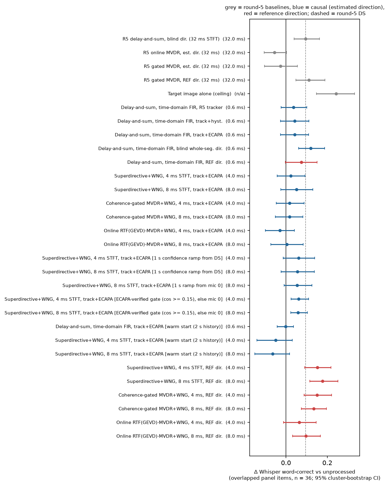
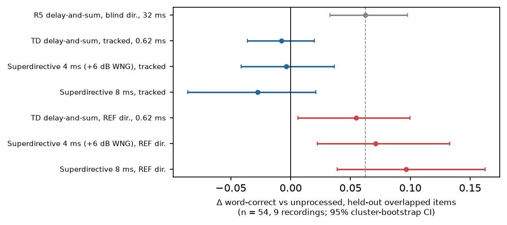
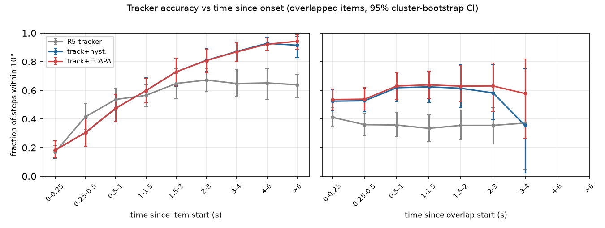

# 1. Bottom line

1. **The question.** Can a *causal* front-end with an open-ear-compatible delay (≤ 5 ms, or ≤ 10 ms at a stretch) beat round 5's best real-data method, delay-and-sum with a blind whole-segment direction and a 32 ms STFT (+0.095 word-correct on overlapped panel items)?
2. **With a tracked direction: no.** On the 48-item panel (36 overlapped, 24 recordings), no causal ≤ 8 ms front-end beat round-5 delay-and-sum. The best tracked version was superdirective 8 ms at +0.051 [95% CI −0.025, +0.130] vs unprocessed. On the **held-out sessions 3-5** (54 overlapped items, 9 recordings), the three frozen tracked front-ends gained **nothing** over unprocessed (−0.028 to −0.004) and were **0.066-0.090 worse than round-5 delay-and-sum**. All three deficits against round-5 DS survive Holm correction (Holm p < 0.001, 0.016 and < 0.001).
3. **With the reference direction: yes on the panel, weaker on the held-out set.** Superdirective 8 ms steered with the reference direction gave +0.177 [+0.115, +0.251] on the panel and still beat round-5 DS after Holm (+0.082, Holm p < 0.001). On held-out sessions it gave **+0.096 [+0.039, +0.162]** vs unprocessed (Holm p < 0.001) but only **+0.034 [−0.007, +0.096]** vs round-5 DS (Holm p = 0.53). Superdirective 4 ms with the reference direction gave +0.152 on the panel; its +0.057 [+0.013, +0.113] edge over DS there does **not** survive Holm (p = 0.23). This corrects the earlier reading that both 4 ms and 8 ms beat DS after correction.
4. **Steering is the bottleneck, and it fails exactly at onsets.** The same filter is worth about +0.10 to +0.15 more word-correct when it points the right way. The causal tracker is right on only **18% of 16-ms steps in the first 0.25 s** and **31% in 0.25-0.5 s** after the target's turn starts. It reaches 87-94% only after 3 s. The ECAPA speaker check barely changes this (0.76 vs 0.76 of steps; end-of-segment 0.87 vs 0.83).
5. **Compute is not the problem.** Idle, single-thread Python: 0.035 ms (time-domain DS) to 0.36 ms (RTF-MVDR 8 ms) mean compute per hop, RTF 0.02-0.10. The tracker with ECAPA costs 2.5 ms per 16 ms step (RTF 0.17). Worst-case hops overrun the 2 ms deadline for the 4 ms STFT filters in this Python code, so a device build needs native code.
6. **The twin ranks methods well but is mildly optimistic for the new beamformers.** Spearman ρ = 0.83 over 8 methods. Real minus sim is −0.02 to −0.07 for the STFT beamformers (no single gap significant). The twin matches round-5 DS almost exactly (+0.095 real vs +0.093 sim).
7. **What this does not show.** All of it is recorded audio, processed offline and scored by Whisper base.en. It does not measure the sound at a listener's ear, nor human intelligibility, and it assumes the system already knows *which* talker the listener wants (section 9).

# 2. What ran

**Data.** The round-5 real set: 144 items from 24 LibriCSS recordings (conditions 0S, OV10, OV20, OV40 × sessions 0-5), 7-mic circular array (centre + 6 mics on r = 4.25 cm), with system-identified references used only for scoring and for the reference-direction upper bounds.

- **Panel:** 48 items (2 per recording; 36 overlapped, 12 no-overlap), all 25 round-6 configurations.
- **Held-out protocol (new):** tune on every item of sessions 0-2 (72 items), freeze, test once on every item of sessions 3-5 (72 items; 54 overlapped in 9 recordings, 18 no-overlap in 3 recordings).
- **Twin:** round-5 fitted simulation (r5sim) of the 48 panel items, 6 round-6 methods transcribed.

**Scoring.** faster-whisper base.en (int8, greedy). Word-correct = hits / reference words. 95% CIs by cluster bootstrap over recordings, 2000 resamples. Holm correction within the family of round-6 methods, per group and per comparison (vs unprocessed; vs round-5 DS). Bootstrap p = 0.000 means p < 1/2000.

# 3. Methods and exact latencies

Algorithmic latency = delay from an input sample to the output sample representing it, excluding compute. A sqrt-Hann WOLA STFT with window *N* and hop *N*/2 has latency *N* samples (round-5 convention). fs = 16 kHz.

| Short name | Filter | Latency |
|---------|-----------------------------------------------------|-------------------|
| ds_td | Time-domain delay-and-sum, 21-tap Kaiser-sinc fractional delays, 2 ms blocks, 2 ms crossfade on steering change | 9.98 samples = **0.62 ms** |
| sd4 / sd8 | Superdirective MVDR (diffuse-field coherence), per-bin loading by bisection for a white-noise-gain (WNG) floor | **4 ms** / **8 ms** |
| gm4 / gm8 | Adaptive MVDR, noise covariance updated on low-coherence bins and non-target frames, WNG floor | **4 ms** / **8 ms** |
| rtf4 / rtf8 | Online RTF (GEVD) MVDR, R_x / R_n gated by the tracker, free-field fallback, WNG floor | **4 ms** / **8 ms** |
| R5 DS | Round-5 delay-and-sum, 32 ms STFT, blind whole-segment direction (non-causal steering) | 32 ms |

**Steering** (32 ms SRP-PHAT frames every 16 ms; adds no audio delay):

- *R5 tracker*: round-5 running SRP-PHAT, re-implemented on strictly causal frames.
- *track+hyst.*: candidate directions from a long running map (forgetting 0.99), persistent tracks (20° gate), short-map dominance with hysteresis.
- *track+ECAPA*: the same tracks plus an ECAPA-TDNN check of each track against a 3-15 s enrolment of the target.
- *REF dir.*: the system-identification azimuth, held constant. **Oracle geometry: an upper bound, not deployable as is.**

Tracker hyper-parameters were chosen on sessions 0-2 only. Post-diagnosis variants (parameters fixed a priori): 1 s confidence ramp, ECAPA-verified gate (cosine ≥ 0.15, else mic 0), 2 s warm start.

# 4. Panel results (48 items, 24 recordings)

**Table 1. Overlapped panel items (n = 36). Δ word-correct, 95% CI, Holm p.** Unprocessed word-correct 0.658.

| Method | Latency | Δ vs unprocessed | Holm p | Δ vs R5 DS | Holm p |
|--------------------------|--------|-------------------------|------|-------------------------|------|
| R5 DS (blind, 32 ms) | 32 ms | +0.095 [+0.040, +0.162] | — | — | — |
| ds_td, R5 tracker | 0.62 ms | +0.036 [−0.023, +0.100] | 1.00 | −0.059 [−0.133, +0.002] | 0.97 |
| ds_td, track+ECAPA | 0.62 ms | +0.042 [−0.026, +0.110] | 1.00 | −0.053 [−0.140, +0.037] | 1.00 |
| ds_td, blind whole-seg. (non-causal) | 0.62 ms | +0.119 [+0.061, +0.187] | <0.001 | +0.024 [−0.009, +0.084] | 1.00 |
| sd4, track+ECAPA | 4 ms | +0.023 [−0.042, +0.092] | 1.00 | −0.072 [−0.149, +0.002] | 0.86 |
| sd8, track+ECAPA | 8 ms | +0.051 [−0.025, +0.130] | 1.00 | −0.044 [−0.133, +0.054] | 1.00 |
| gm4, track+ECAPA | 4 ms | +0.018 [−0.047, +0.088] | 1.00 | −0.077 [−0.146, −0.019] | 0.040 |
| rtf4, track+ECAPA | 4 ms | −0.029 [−0.099, +0.041] | 1.00 | −0.124 [−0.200, −0.056] | <0.001 |
| sd4 + 1 s ramp | 4 ms | +0.062 [−0.013, +0.138] | 1.00 | −0.033 [−0.128, +0.073] | 1.00 |
| sd4 + ECAPA gate | 4 ms | +0.062 [+0.024, +0.110] | <0.001 | −0.034 [−0.105, +0.029] | 1.00 |
| sd8 + ECAPA gate | 8 ms | +0.059 [+0.023, +0.104] | <0.001 | −0.037 [−0.107, +0.027] | 1.00 |
| sd8 + warm start | 8 ms | −0.064 [−0.151, +0.018] | 1.00 | −0.159 [−0.277, −0.059] | <0.001 |
| ds_td, REF dir. | 0.62 ms | +0.074 [−0.004, +0.150] | 0.92 | −0.021 [−0.071, +0.008] | 1.00 |
| sd4, REF dir. | 4 ms | +0.152 [+0.091, +0.217] | <0.001 | +0.057 [+0.013, +0.113] | 0.23 |
| sd8, REF dir. | 8 ms | +0.177 [+0.115, +0.251] | <0.001 | +0.082 [+0.021, +0.163] | <0.001 |
| gm4, REF dir. | 4 ms | +0.151 [+0.087, +0.221] | <0.001 | +0.055 [−0.028, +0.146] | 1.00 |
| rtf8, REF dir. | 8 ms | +0.097 [+0.032, +0.167] | 0.018 | +0.001 [−0.080, +0.089] | 1.00 |
| Target image (ceiling) | — | +0.242 [+0.147, +0.333] | — | +0.147 [+0.048, +0.259] | — |

{width=85%}

**No-overlap items (n = 12).** Every tracked and reference-direction superdirective or delay-and-sum method was within ±0.02 of unprocessed (e.g. sd8 tracked +0.020 [+0.002, +0.048]). Coherence-gated MVDR 8 ms tracked cost −0.030 [−0.054, −0.006]. No 0S effect survives Holm.

The full 25-method tables, per-condition breakdown (OV10/20/40) and objective metrics are in `results/r6/summary_r6.md`.

# 5. Held-out test (sessions 3-5)

**Selection rule** (fixed before the test): per latency class (≤ 5 ms, ≤ 10 ms) and separately within the STFT-beamformer family, the configuration with the largest mean Δ word-correct vs unprocessed on overlapped tuning items (sessions 0-2, n = 54), subject to a 0S Δ ≥ −0.02. Frozen: **ds_td tracked** (tuning +0.094), **sd4 tracked with a +6 dB WNG floor** (+0.086), **sd8 tracked** (+0.082), plus their reference-direction versions with the same parameters.

**Table 3. Held-out overlapped items (n = 54, 9 recordings).** Unprocessed word-correct 0.757.

| Method | Δ vs unprocessed | Holm p | Δ vs R5 DS | Holm p |
|--------------------------------|-------------------------|------|-------------------------|------|
| R5 DS (blind, 32 ms) | +0.062 [+0.033, +0.098] | — | — | — |
| ds_td, tracked (0.62 ms) | −0.008 [−0.036, +0.020] | 1.00 | −0.070 [−0.111, −0.031] | <0.001 |
| sd4 +6 dB WNG, tracked (4 ms) | −0.004 [−0.041, +0.037] | 1.00 | −0.066 [−0.110, −0.021] | 0.016 |
| sd8, tracked (8 ms) | −0.028 [−0.086, +0.021] | 0.96 | −0.090 [−0.152, −0.033] | <0.001 |
| ds_td, REF dir. | +0.054 [+0.006, +0.100] | 0.092 | −0.008 [−0.046, +0.025] | 1.00 |
| sd4 +6 dB WNG, REF dir. | +0.071 [+0.022, +0.133] | 0.005 | +0.008 [−0.042, +0.076] | 1.00 |
| sd8, REF dir. | +0.096 [+0.039, +0.162] | <0.001 | +0.034 [−0.007, +0.096] | 0.53 |

{width=70%}

**Held-out no-overlap items (n = 18, 3 recordings):** all methods within +0.003 to +0.014 of unprocessed, none significant. No method harmed single-talker speech.

**Reading.** The tuning-set gains of the tracked front-ends (+0.08 to +0.09) vanished on the test sessions. Part of this is selection optimism (15 configurations scored on the same 54 items). Part is session-to-session variation: round-5 DS itself drops from +0.095 on the panel to +0.062 here. The reference-direction superdirective result replicates against unprocessed but its margin over round-5 DS does not. Whisper catastrophic failures (word-correct < 0.3) on held-out overlapped items: unprocessed 9%, round-5 DS 6%, sd8 tracked 15%, sd8 REF dir. 4% (`results/r6/whisper_brittleness_holdout.csv`).

Pooled over all 144 items (optimistic, because sessions 0-2 were the tuning set): sd8 REF dir. +0.114 [+0.065, +0.171] vs unprocessed and +0.050 [+0.007, +0.109] vs DS (Holm p = 0.060); sd8 tracked +0.027 [−0.020, +0.078].

# 6. Tracker accuracy

**Table 4. All 122 items with a reference (90 overlapped).** Fraction of 16-ms steps within 10° of the reference.

| Tracker | Group | Steps within 10° | End-of-segment within 10° | Median end error |
|------------|------------------|-------------------|--------------------|----------|
| R5 tracker | 0S (n = 32) | 0.79 [0.74, 0.85] | 0.91 [0.83, 0.97] | 4.2° |
| R5 tracker | overlapped (n = 90) | 0.61 [0.53, 0.69] | 0.43 [0.33, 0.53] | 15.2° |
| track+hyst. | 0S | 0.90 [0.86, 0.93] | 1.00 | 2.0° |
| track+hyst. | overlapped | 0.76 [0.70, 0.82] | 0.83 [0.74, 0.91] | 2.5° |
| track+ECAPA | 0S | 0.90 [0.86, 0.93] | 1.00 | 2.0° |
| track+ECAPA | overlapped | 0.76 [0.70, 0.82] | 0.87 [0.79, 0.93] | 2.5° |

On steps during which both talkers are active, track+ECAPA is right 60% of the time (R5 tracker 39%).

**Onset curve** (overlapped items, track+ECAPA, fraction of steps within 10° by time since the item, i.e. the target turn, starts): 0.18 [0.13, 0.25] in 0-0.25 s, 0.31 [0.21, 0.41] in 0.25-0.5 s, 0.48 in 0.5-1 s, 0.60 in 1-1.5 s, 0.73 in 1.5-2 s, 0.81 in 2-3 s, 0.87 in 3-4 s and 0.92-0.94 after 4 s. The R5 tracker plateaus at about 0.65. Measured from the start of each overlap interval instead, track+ECAPA stays at 0.53-0.64 throughout. The first second of each turn, which is where listeners most need help and where the warm start and ramp variants tried to help, is where steering is worst.

{width=95%}

\newpage

# 7. Simulation vs real

**Table 5. Panel overlapped items (n = 36), paired by item.** Spearman rank correlation of the 8 method effects: 0.83.

| Method | Δ real | Δ sim | Real − sim [95% CI] |
|---|---|---|---|
| R5 DS (blind, 32 ms) | +0.095 | +0.093 | +0.002 [−0.100, +0.102] |
| R5 online MVDR (32 ms) | −0.055 | +0.038 | −0.093 [−0.185, −0.007] |
| ds_td, tracked | +0.042 | +0.013 | +0.029 [−0.074, +0.157] |
| sd4, tracked | +0.023 | +0.063 | −0.040 [−0.158, +0.082] |
| sd8, tracked | +0.051 | +0.073 | −0.021 [−0.143, +0.119] |
| gm4, tracked | +0.018 | +0.058 | −0.040 [−0.181, +0.104] |
| sd4, REF dir. | +0.152 | +0.226 | −0.074 [−0.179, +0.018] |
| sd8, REF dir. | +0.177 | +0.213 | −0.036 [−0.141, +0.061] |

The twin gets the order right and is mildly optimistic for the STFT beamformers, by much less than the 0.10-0.18 round-5 gap for online MVDR and TSE.

# 8. Idle compute

Single thread, Python/numpy reference code, 2 vCPU aarch64, 8 overlapped panel items (54.6 s of audio), mean load average 0.65 (nothing else of ours running).

| Component | Latency | Hop | Mean per hop | p99 per hop | Worst hop | RTF |
|------------|--------|-------|----------|----------|----------|------------------|
| ds_td | 0.62 ms | 2 ms | 0.035 ms | 0.40 ms | 1.46 ms | 0.017 |
| sd4 | 4 ms | 2 ms | 0.046 ms | 0.82 ms | 2.52 ms | 0.021 |
| sd8 | 8 ms | 4 ms | 0.100 ms | 2.63 ms | 3.64 ms | 0.021 |
| gm4 | 4 ms | 2 ms | 0.115 ms | 1.00 ms | 3.84 ms | 0.055 |
| gm8 | 8 ms | 4 ms | 0.228 ms | 2.90 ms | 4.98 ms | 0.053 |
| rtf4 | 4 ms | 2 ms | 0.146 ms | 1.21 ms | 3.65 ms | 0.074 |
| rtf8 | 8 ms | 4 ms | 0.363 ms | 3.09 ms | 4.32 ms | 0.097 |
| R5 tracker | — | 16 ms | 1.28 ms | — | — | 0.080 |
| track+hyst. | — | 16 ms | 1.37 ms | — | — | 0.085 |
| track+ECAPA | — | 16 ms | 2.49 ms | — | — | 0.167 (ECAPA 0.079) |

Mean cost is 1-10% of real time. The tail is the issue: in this Python code the worst hop exceeds the hop length for sd4, gm4, gm8, rtf4 and rtf8 (the count of overruns was not logged). A first, loaded run gave the same means (within 10%); the idle run is the one reported. Max-hop figures are from `results/r6/timing_r6.csv`.

# 9. Critique

- **Tuning hygiene.** Tracker parameters and the filter grid were tuned on sessions 0-2 only and the test was run once. But the panel spans all six sessions (24 of its 48 items are from sessions 3-5), and the post-diagnosis variants (ramp, ECAPA gate, warm start) were designed after looking at panel results. None of those variants was frozen, so the frozen picks are clean, but the decision to add a WNG grid point and the variants was informed by data that includes test sessions. The held-out result is the one to trust.
- **Whisper truncates after interferer words.** Whisper base.en often transcribes the interfering talker's words, or stops after them, giving near-zero word-correct for a whole item (listening clip 05: unprocessed "as well as first", 0.00; round-5 DS gets 0.91). On the panel 17% of unprocessed overlapped items were catastrophic. This makes the metric bimodal: a front-end that tips Whisper onto the target's first words gains a whole sentence, one that tips it the other way loses one. Effects are therefore larger and noisier than an intelligibility measure would give, and tracker errors at onset are penalised far more than errors later in the item.
- **n = 36 instability.** With 24 clusters, CI half-widths are ±0.06-0.08. Rankings among tracked methods flip between panel and held-out (sd8 tracked: +0.051 panel, −0.028 test). The held-out overlapped set has only 9 recordings, so its cluster-bootstrap CIs are themselves likely too narrow.
- **Holm.** The family is the 25 round-6 configurations per group and comparison, which is conservative. Under it, sd4 REF dir. vs DS (uncorrected CI excludes 0) is not significant, and the held-out sd8 REF dir. vs DS is not either. No tracked front-end is significantly better than round-5 DS anywhere.
- **Objective metrics** (SI-SDR / ESTOI vs the *estimated* reverberant target image at mic 0, overlapped panel): all methods are slightly negative, including the best ASR methods (sd8 REF dir. −0.51 dB [−1.19, +0.20], ESTOI −0.014). The reference itself is the mic-0 reverberant image with a −10 dB residual, so any spatial filter is penalised for changing the reverberant colouration. Indicative only; they disagree with the ASR ranking and are not used for conclusions.

# 10. What this does and does not establish about real-world listening

- **It does establish** that on real 7-mic recordings, a 4-8 ms causal superdirective beamformer *pointed at the right talker* recovers a substantial part of the gap to the clean target (panel: +0.177 of the +0.242 ceiling for sd8; held-out +0.096), at negligible mean compute; and that without a correct direction the same filters give nothing reliable.
- **It does not establish** what reaches a listener's ear. This is a recorded-audio front-end scored by an ASR proxy. An open-ear device adds its output to the direct sound at the ear, so the benefit is diluted by the unprocessed path, and only front-ends ≤ 5 ms (ds_td 0.62 ms, sd4 4 ms) avoid audible comb filtering; sd8 does not meet that budget. The array here is a 4.25 cm table-top circle, the talkers are loudspeakers, and nobody moves. Human intelligibility was not measured.
- **Intent cues are needed.** The reference-direction result is an oracle for *which* talker. In conversation the wanted talker changes, and an acoustic tracker can only find it after it has talked for 1-3 s. A device needs a cue of the listener's intent, such as head orientation or gaze, to steer at the start of a turn.

# 11. Limitations

- Whisper base.en is a proxy for intelligibility, with the truncation failure mode above.
- Reference direction and reference image come from system identification on loudspeaker playback; live talkers move and turn.
- 24 recordings, one room, one array; the held-out set is 9 overlapped recordings.
- Timing is Python reference code on a shared 2 vCPU machine; overrun counts were not logged.
- The onset curve uses the item start as the target-turn onset and the round-5 busy intervals for overlaps; it does not use diarised turn boundaries inside an item.
- The 4 ms superdirective in the twin and on the panel uses the default 0 dB WNG floor; the held-out pick uses +6 dB.

# 12. Next three experiments

1. **Intent-cue steering.** Replace the acoustic tracker with a head- or gaze-direction signal (simulated from the reference azimuth with realistic error and lag first, then a recorded head-tracker), and measure how much of the REF-dir. gain (+0.10 to +0.18) survives at 0.62-4 ms latency.
2. **A non-truncating ASR plus a human listening test.** Re-score with a stronger, long-form ASR (e.g. Whisper large-v3 with timestamps, or a CTC model that cannot stop early), and run the built listening test with **12+ people** on unprocessed vs round-5 DS vs sd4/sd8 tracked vs REF dir.
3. **Fast speaker-gated switching at onsets.** Keep a bank of beams on all candidate tracks and switch to the one whose short ECAPA (or voice-activity) evidence matches the target within 100-250 ms of a turn start, instead of waiting for the long map. Score with the onset curve and word-correct on the first second.

# 13. What was cut

- Twin transcription was **not** cut: all 6 methods (sd8, sd4, ds_td tracked; sd8, sd4 REF dir.; gm4 tracked) ran on all 48 items.
- gm8 / rtf8 / ds_td REF dir. in the twin; objective metrics on the held-out set; full-144 ASR for the non-frozen configurations.
- Native (C/Rust) timing of the round-6 filters and an overrun count.
- Human listening data; in-ear measurement; live talkers.

# 14. Files

- Results tables: `results/r6/summary_r6.md` (all tables), `asr_holdout_test.csv`, `asr_panel_r5.csv`, `holdout_choice.json`, `holdout_tune.csv`.
- Tracker, twin, compute: `tracker_r5.csv`, `tracker_onset.csv`, `sim_vs_real_r6.csv`, `timing_r6.csv`, `timing_r6_summary.csv`.
- Other: `objective_panel_r5.csv`, `whisper_brittleness_panel.csv`, `whisper_brittleness_holdout.csv`; figures in `results/r6/figs/`.
- Code: `selab/r6.py`, `run_r6.py`, `score_r6.py`, `holdout_r6.py`, `summary_r6.py`, `onset_r6.py`, `timing_r6.py`, `listening_r6.py`; driver `scripts/run_round6.sh`.
- Listening pack: `listening/r6/` and `../round6_listening.zip` (6 sets × 4 versions: unprocessed, round-5 DS, sd8 tracked, sd8 REF dir.; rule-based picks, not typical).
- App: `app.py` multichannel tab, round-6 superdirective 4 ms (+6 dB WNG) and 8 ms options.
