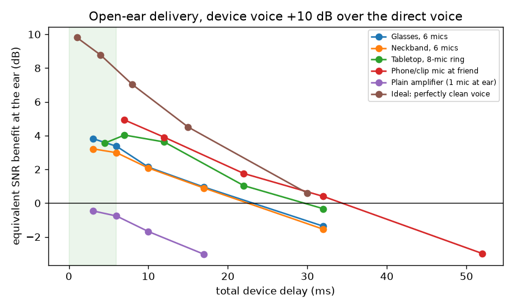
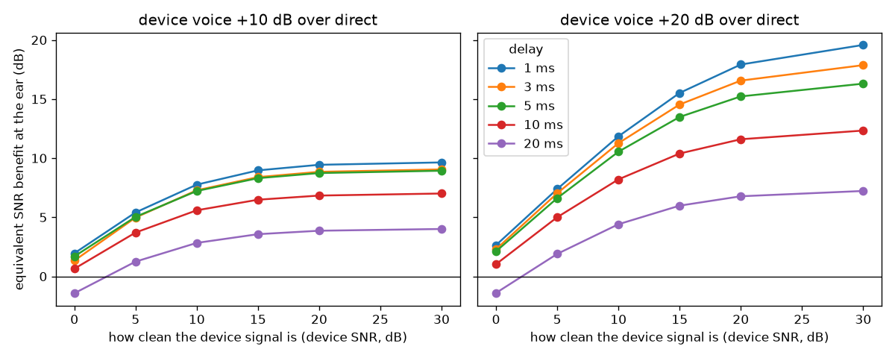

# 1. Bottom line

- **The bottleneck is how clean the device's own copy of your friend's voice is, not cancelling the room.** In our open-ear simulation, a wearable array (glasses, neckband) or a tabletop ring adds about **+3.2 to +3.8 dB** of equivalent SNR at the ear, or +4.2 to +5.3 dB when its output is played 20 dB above the direct voice. That matches the **2.2 to 4.4 dB** measured for Nuance Audio hearing glasses, which validates the model.
- **There is a lot of headroom.** If the device's signal were 10 dB cleaner than the room (device SNR 10 dB), the same open-ear delivery would give **+7.3 dB** (at +10 dB playback) to **+11.3 dB** (at +20 dB). At a device SNR of 15 to 20 dB it gives up to about **+14.5 to +16.6 dB**. That is the target-speaker-extraction or remote-mic regime.
- **Delay costs about 0.2 to 0.3 dB of benefit per millisecond.** Keep the device's total delay at **5 ms or less** for open delivery. At 17 ms, glasses fall from +3.8 to +1.0 dB; at 30 ms, everything is roughly zero or negative. Bluetooth-class streaming (about 20 ms or more) erases most of a remote mic's advantage.
- **What doesn't work:** a plain amplifier (one mic, no directionality) makes things worse (−0.5 dB). Neither "averaging" babble (stationary-noise suppression) nor adding an 8 ms single-channel post-filter helps. Open-air active cancellation can't touch speech-band babble.
- **What does:** get the cleanest possible capture (mic close to the talker, a big array, voice-aware extraction), deliver it within 5 ms, and play it close to the ear so it doesn't raise the room level.

# 2. Simulation method

- **Scenes:** 21 reverberant bar scenes (RT60 0.55 to 0.85 s, 10 to 14 m rooms), each at input SNR −5 and 0 dB, giving 42 cells.
  - The friend talks from 1.0 m across a table.
  - Noise comes from 8 talkers at 1.6 to 5 m, plus 2 loudspeakers playing recorded crowd babble (MS-SNSD).
  - Speech is from CMU ARCTIC and LibriSpeech, with image-method acoustics (pyroomacoustics).
- **Capture options:** 6-mic glasses frame; 6-mic neckband (20 cm below the ears); 8-mic tabletop ring (0.5 m ahead); a phone or clip mic on the friend; a 1-mic ear-level amplifier.
  - The arrays use a fixed superdirective beamformer with near-field steering to the friend, implemented as a causal FIR (2 or 8 ms).
  - An optional 8 ms streaming Wiener post-filter was also tested.
- **Delivery:** the ear receives the direct sound plus the device output, delayed and played 0, 10 or 20 dB above the direct voice. Open-ear delivery leaves the noise at full level. A 25 dB isolating "in-ear" case is included for comparison.
  - An **ideal device** that emits the perfectly clean voice sets the physics ceiling.
- **Metric:** ESTOI, measured against the friend's early (direct + 50 ms) sound at the ear, converted to an **equivalent SNR benefit**. That is how many dB quieter the room would need to be, unaided, to understand equally well. This is the same unit hearing devices are rated in. 95% CIs come from scene-level variation.
- **Capture sweep:** a separate sweep replaced the beamformer with a device signal of controlled cleanliness (device SNR 0 to 30 dB). This maps *any* front end (beamformer, causal TSE, table hub) onto the listener's benefit.
- **Limitations:** no head or torso acoustics, no acoustic feedback (which limits real open-ear gain), no Lombard speech, ESTOI rather than human listeners, and a static talker.

# 3. Results

**Benefit by form factor (open ear, shortest realistic delay)**

| Form factor | Delay | +10 dB playback | +20 dB playback |
|---|---|---|---|
| Plain amplifier (1 mic at ear) | 3 ms | −0.5 dB | −0.2 dB |
| Neckband, 6 mics | 3 ms | +3.2 dB | +4.2 dB |
| Tabletop, 8-mic ring | 4.5 ms | +3.6 dB | +5.3 dB |
| Glasses, 6 mics | 3 ms | +3.8 dB | +4.7 dB |
| Phone/clip mic at friend | 7 ms | +4.9 dB | +6.2 dB |
| Ideal clean voice (ceiling) | 1 ms | +9.8 dB | +19.7 dB |

All CIs are within ±0.35 dB.

{width=88%}

**Delay.**

- Glasses: +3.8 dB at 3 ms, +2.1 at 10 ms, +1.0 at 17 ms, −1.4 at 32 ms.
- Phone mic: +4.9 dB at 7 ms, +1.75 at 22 ms, −3.0 at 52 ms.
- Ideal voice: +9.8 dB at 1 ms, +4.5 at 15 ms, +0.6 at 30 ms.
- The delayed copy blurs the speech envelope and comb-filters the direct sound. That is the same physics behind the hearing-aid literature's 5 to 10 ms open-fit limit.

{width=88%}

**Device cleanliness is the lever.**

- At 3 ms and +20 dB playback, the benefit is +2.3 dB at device SNR 0, +7.0 at 5, +11.3 at 10, +14.5 at 15, and +16.6 at 20.
- Our fixed beamformers only raise the device SNR about **1.3 to 2.6 dB** above the ear's own SNR in diffuse babble. The phone at the friend raises it about **5.3 dB**.
- Round 3 showed offline target-speaker extraction adding about +10 dB SI-SDR on unseen talkers. UW's causal TSE gets 7 dB at 12 to 18 ms. **A low-latency voice-aware front end is therefore worth roughly 2 to 3 times the benefit of today's glasses.**

**Post-filter:**

- An 8 ms Wiener post-filter *lowered* the benefit for glasses (+3.8 to +2.6 dB) and the neckband (+3.2 to +2.1 dB).
- It added nothing at the tabletop (+3.55 to +3.65 dB).
- It costs delay and doesn't remove babble.

**In-ear comparison:** isolating the ear adds only about 1 dB with these noisy device signals. With the ideal clean voice it adds +27 dB at 1 ms. Isolation only pays off when the capture is clean.

# 4. Predictive traffic experiment

- **Scene:** a street café, with 30 sentences × SNR −5/0/+5 dB and 1 to 3 cars passing per clip.
  - Cars are ESC-50 engine textures shaped by the physical pass-by law L(t) ∝ 1/(d0² + v²(t−t0)²).
  - Every variant uses the same 8 ms streaming Wiener filter.

| Noise estimate | ΔSI-SDR | ΔESTOI |
|---|---|---|
| Blind minimum-statistics tracker (usual) | +0.8 dB | +0.011 |
| Blind fast tracker (0.3 s) | +0.7 dB | −0.027 |
| **Predictive (up-street sensor forecasts each car's rise; ±2 dB error)** | **+3.7 dB** | +0.023 |
| Oracle noise (upper bound) | +5.2 dB | +0.111 |

Predicting the pass-by **quadruples noise removal** (+0.8 → +3.7 dB SI-SDR), because blind trackers lag each car by about a second. With a simple low-latency gain rule it barely moves intelligibility (+0.023 ESTOI). It's useful for comfort, and as a feed into a smarter suppressor or a gain-riding voice boost, but it isn't a hearing solution on its own.

**"Averaging" babble** (stationary-noise suppression) was measured in Round 3 on recorded café babble: +0.9 dB SI-SDR and +0.009 ESTOI. It's real but tiny, as theory predicts, because babble's average spectrum is speech's spectrum.

# 5. Solution map: seven approaches at different levels

**1. Table hub + neckband ("virtual headphones without headphones")**

- **How it works:** a centerpiece mic array runs beamforming plus voice-aware extraction for each tablemate, with enrolment-free speaker clustering. It streams each voice over a ≤5 ms proprietary radio link to a neckband with near-ear speakers 10 to 15 cm from each ear, played a few dB above the local noise.
- **Expected benefit:** **+7 to 11 dB** if the hub reaches device SNR ≥10 dB and ≤5 ms (sim). Today's parts give +3.5 to 5 dB.
- **Maturity:** components ship (Roger/Orsana table mics, neck speakers, LE Audio); the integration doesn't. Patent TableConverse (US 12,354,619) is nearby prior art.
- **Key risk:** radio latency, feedback, privacy.

**2. Wireless look-ahead relay ("faster than sound")**

- **How it works:** a table or venue node radios the sound before it arrives acoustically (about 3 ms per metre of head start). That buys compute time for heavier extraction, or a reference for cancellation (MUTE, SIGCOMM 2018: open-ear cancellation 0 to 4 kHz for a single source).
- **Expected benefit:** turns the 5 ms budget into about 8 to 15 ms of usable compute for distant noise sources.
- **Maturity:** research.

**3. Large-aperture wearable array with gaze or head steering (glasses / neckband)**

- **How it works:** 6 to 16 mics, steered toward where you look (Kidd's visually guided hearing aid) or face, plus a tiny causal neural spatial filter (GCFSnet, 5.4 ms, +1.3 dB over the classical beamformer).
- **Expected benefit:** **+4 to 7 dB** (sim plus literature: Varibel 5.3 to 6.3, Widrow necklace >10 dB measured in 2003).
- **Maturity:** Nuance (2.2 to 4.4 dB) and Meta (no data) ship; a bigger array plus AI is open space.

**4. Predictive environmental modeling (traffic, music, HVAC)**

- **How it works:** forecast each noise event's rise from up-street or venue sensors (car pass-by, bus, DJ drop). Pre-adjust suppression and voice boost before the noise peaks; use order-tracking for engine harmonics.
- **Expected benefit:** **+3 dB less noise** in our traffic sim (vs +0.8 blind). It's a comfort feature, with a small intelligibility gain unless paired with a better suppressor.
- **Maturity:** no published hearing-device work (gap). The closest is Oticon's motion-intent sensors.

**5. "Duck the DJ" and venue integration**

- **How it works:** the house music is the one loud noise available *electronically before it plays*. Use it as a perfect cancellation reference for bass at chair-backs or neckbands (quiet zones of 7 to 34 cm below 500 Hz). Or zone and duck venue speakers near tables that request it.
- **Expected benefit:** 5 to 10 dB less music bass locally (inferred from headrest ANC results); whole-venue absorption gives up to about 10 dB of reverberant reduction.
- **Maturity:** speculative as a product; the ANC pieces are proven in cars and headrests.

**6. Seat, booth or headrest local ANC plus near-ear speech**

- **How it works:** head-tracked headrest cancellation (Elliott 2018: about 20 dB at 300 Hz to 1 kHz in the lab; Silentium claims about 10 dBA), or booth-aperture cancellation (Lam 2020 window ANC: 7.5 to 10 dBA). Add seat-back speakers for boosted speech.
- **Expected benefit:** good on rumble, hum and music, little on chatter; only when people lean back.
- **Maturity:** car and aircraft seats are near production; a restaurant chair is speculative.

**7. Directional delivery: ultrasonic or speaker-array "sound spotlights" from a lamp or centerpiece**

- **How it works:** parametric beams (Holosonics, 85 to 95 dB max, about 0.5 m spot at 2 m) or sound-zone arrays (about 15 dB of bright/dark contrast) put the boosted voice at one head without filling the room, which avoids the Lombard spiral.
- **Expected benefit:** about +5 to 10 dB of speech at the target head, weak bass, needs head tracking.
- **Maturity:** hardware ships; table use is unproven. Check ultrasound exposure limits.

**Not worth pursuing:**

- Open-air ANC of babble at speech frequencies (the quiet zone is about 3 cm at 1 kHz).
- Masking noise (it lowers the SNR).
- One-mic amplifiers.
- Single-mic neural denoisers at ≤16 ms (Round 3).
- Bluetooth-latency phone streaming to open ears.

# 6. Competitive landscape

**Hearing glasses**

- Nuance Audio (6 mics, measured +2.2 to 4.4 dB, $699): Nuance Audio Plus launched Sep 29, 2026, from $829.
- Legato raised $12M in Aug 2026.
- Meta's Conversation Focus (no published dB; capped free use).

**DNN hearing aids**

- Phonak Sphere Infinio: +5.9 dB vs open ear (vendor), in-ear, prescription.
- Phonak Roger On Sphere: an AI table/remote mic shipping mid-Nov 2026.

**Remote / table mics:** Roger, Orsana. Remote mics measured +14 to 22.7 dB, but listeners wear receivers or earbuds.

**Research leaders:** UW (Target Speech Hearing 7 dB causal; Sound Bubble), Oldenburg (GCFSnet), Boston University (Kidd, gaze steering), MUTE (UIUC).

**White space:**

- An earbud-free system that uses a table node's clean capture plus ≤5 ms near-ear delivery, sold to people with normal hearing.
- Nobody publishes conversation-benefit numbers for neck-worn speakers.

# 7. Recommended next experiments

1. **Causal TSE at ≤5 ms on a table hub:** distil the Round-3 TSE into a streaming model, then feed it into the capture sweep. This tests whether a device SNR of 10 dB or more is reachable.
2. **Head and torso model plus feedback:** add HRTFs and speaker-to-mic feedback paths for the neckband and glasses, to find the maximum stable playback gain (we assumed up to +20 dB).
3. **Real recordings:** an 8-mic dev board (e.g. ReSpeaker or miniDSP UMA-8) at a real Omaha restaurant, run through the same pipeline, plus a 12-person listening test with the existing app.
4. **Predictive suppressor v2:** pair the pass-by forecast with a neural suppressor and gain-riding voice boost, and measure ESTOI.
5. **"Duck the DJ" bench test:** headrest-scale ANC with an electronic music reference, measured on a dummy head.

*Appendices A and B: full research memos with sources.*
